# Are the manuscript's MATTR drops the generators' collapses? Templates on the page, tested directly

**28 October 2026 positional recheck:** [The alignment rerun](alignment_rerun_20261028/RESULTS.md)
recomputes the spatial diversity/repetition association, paragraph/page shuffle controls, comparison layouts,
and held-out prediction using the reviewed assignments. The results below remain the historical 27 October
record; reproduction now selects historical geometry explicitly instead of inheriting the app's default.

26 October 2026. Follow-up to the governed self-citation study (`research/dynamic_selfcitation_20261024/governed`, RESULTS sections 25, 30, 34 to 38) and the layout audit (`research/timm_geometry_audit_20261026`). Those studies explained why the copying generators lose local diversity (the page window shrinks at page and paragraph transitions, the source choice concentrates, the text recycles its own recent forms until something replenishes the supply) and found the manuscript falling in the same places in a regional sense, without a transferable rule. This study asks the question the other way round: **does the manuscript's local diversity carry the fingerprints that copying from the page leaves in every generator?** Three fingerprints are measured in the manuscript and in the same generators on the same page layout, with natural-language prose as a second reference. None of the three is present in the manuscript. A timing follow-up (section 5, 27 October) checks the claim that the generators fall at the same points as the manuscript.

**Result.** Every regional step of the manuscript's MATTR (1b→1.5a +0.059, 3b→3a −0.048, 3c→4c −0.074, 4c→4a −0.057) is, to within 0.013, a change of the expectation after shuffling the bifolium's own words (+0.071, −0.047, −0.070, −0.050): a change in which words are in use and how unevenly, with almost no change in how closely the repeats cluster. That decomposition does not by itself name the mechanism (user's correction, 27 October): in a copier with mutation the word bag is a product of the copying and of how many words are in view, and the page copiers under this layout move their bags too (into Bio, the no-innovator far 0 run by −0.050 of its −0.099, Original Timm by −0.015 of −0.069). What separates the manuscript from them is the other component. Copying from the page clusters repeats locally, so the copiers' falls into Bio carry a clustering change of −0.049 to −0.054, half to four fifths of the fall, on a clustering level of 0.05 to 0.15; the manuscript's clustering changes by −0.011 and stands at 0.022 to 0.045, inside the range of natural prose (0.03 to 0.10). The layout-only generator (Original Timm under the manuscript's page geometry) reaches two of those falls in direction, but through that other channel: 55 to 62 percent of his falls are clustering, 65 percent of his total diversity loss is page-level concentration, and across the 50 bifolia his profile is uncorrelated with the manuscript's (r = +0.03). The manuscript's loss of local diversity is spread thinly over bifolium, page and within-page scales (0.012, 0.008, 0.009), a profile inside the range of eight natural-language texts laid into the same page structure, where the page-window generators lose 0.064 to 0.067 at the page level alone. Physically seeing the previous page adds nothing to the re-use of its words (same face of the sheet versus flipped: +0.0 per 1,000 word pairs, 95% CI −1.3 to +1.4, p = 0.97), and the page boundary costs the manuscript's word re-use 14 percent in Herbal and 9 in Stars where it costs the generators 22 to 54 percent; in Bio, and only there, the manuscript's page boundary is a break of the generators' size (40 percent), the Bio page being a vocabulary unit that opens with new words rather than a starved one (section 6). A within-bifolium, token-level association between the diversity of the words in view and the next word's chance of being a repeat does exist (section 7, reproducing the component-impact study): it is one third of the size a page-copying generator produces (half to three quarters, at fixed pool size), is read as well from the tokens written after N as from those in view (the cone mirrored below N gives +0.032 against +0.036 above, a paired difference of +0.004, −0.019 to +0.026, where Original Timm's is +0.068 and the copiers of the words in view give +0.010 to +0.042; section 7, item 7), is carried by N's own line and not by the lines above it (with a cone of other lines only and twins inside it not counted, the manuscript's contrast is at the level of its paragraph shuffle, +0.014 and +0.022 at fixed pool size against +0.020 and +0.019, −0.015 unstratified, while every copier keeps +0.06 to +0.08; item 8), is absent in the Markov chains and in prose under the recorded rectangles, vanishes when the manuscript's words are shuffled inside their paragraphs, and in Bio is within the noise of a layout-blind bag model (section 8). Natural prose and a stationary Markov text reflowed into the manuscript's own lines and word boxes show no fall in the Bio layout; both innovator-free self-citation streams fall there, most of the fall being clustering (Original Timm four fifths, the no-innovator far 0 run half); a Markov chain trained per section, generated blind to the layout, reproduces the fall into Bio as a pure bag change (−0.100 against −0.128, no clustering change) while whole-manuscript and Currier chains are flat (section 8). The availability of word templates on the page does not account for the manuscript's MATTR trajectory; what it adds is a small within-paragraph effect, the local bursts of repetition of section 5, which the paragraph shuffle removes.

**Stream status (27 October, user's direction).** Of the five saved generator streams, three ran with the slot innovator on: far 0 (`m_far0*`, innovate = True; 2,260 innovated tokens of 45,378 in seed 1), the 100-form memory (`n_final*`, 2,298) and the 2,000-token pool (`m_final*`, 2,345). A stream that invents a twentieth of its words outside the copying mechanism is not a test of template availability, so those three are out of the figures and the reading; their rows stay in the tables as recorded, marked †. The innovator-free self-citation streams are Original Timm (`m_timm`: Timm's own source choice from the page, innovate = False) and the no-innovator far 0 run (`n_noinnov_far0*`: the governed hooks on Timm's page window, innovate = False); these are the generators in every figure and on the verification pages.

Figures: `scales.png` (where each text loses local diversity; manuscript and Timm along the route), `route.png` (actual against shuffled MATTR per bifolium; clustering gaps), `visibility.png` (re-use across page boundaries by physical relation).

## 1. Data and instruments

- Manuscript: the study transcription of the self-citation work (`tokens.json`, 4,130 paragraph-text lines, 34,977 tokens, 207 pages) in Path 1 order, the rows every generated stream is line-aligned to. Leaf, side and bifolium from team Golf's `physical_map.csv`. Words are the study's token strings; no new EVA parsing.
- Golf 2.1 groups and the traditional sections. The groups are stretches of the bifolium order (Path 1); their pages fall in the traditional sections as follows (share of the group's tokens; Herbal split by Currier language): 1a, 1b, 1.5a = Herbal A (1a has one text-only page); 2a = Pharma 73 percent, Herbal A 15, Astro 9, Cosmo 3; 5a = Cosmo; 6 = Stars; 3b, 3a = Herbal B (3b has one text-only page); 3c = Stars 81 percent, text-only pages 14, Cosmo 5; 4c = Stars; 4a = Bio (one text-only page). Every figure prints the section name under the group code (`data.GROUP_SECTION`).
- Generated streams, all under the manuscript's page geometry, line-aligned to the same 4,130 rows: Original Timm, 5 seeds (`runs/m_timm` and the four retained native seeds of the layout audit); governed, page window only, far 0 (`m_far0*`, 3 seeds; innovator on †); the two hooks on Timm's page window without innovator (`n_noinnov_far0*`, 3); governed + innovator with the 100-form running memory (`n_final*`, 3; †); governed + innovator with the 2,000-token pool (`m_final*`, 3; †). Streams are averaged over seeds. † = innovator on: kept in the tables as recorded, out of the figures and the reading (stream status above).
- Natural-language references: Latin medical prose (Galen *De simplicibus* Würzburg, Dioscorides Longobardus, Rhazes *Almansor*, Hildegard *Physica*, Vulgate), German (*Gart der Gesundheit* 1487), Middle High German and Italian controls; lower-cased letter strings, cut to the manuscript's exact bifolium or page sizes at random offsets (`decompose.py`, `scales.py`).
- Measures. `fresh_i` = 1 when token i did not occur among the previous 100 tokens (the increments of the trailing distinct count D100; its mean over a stretch is the stretch's MATTR100). MATTR100 of a unit uses windows wholly inside the unit. `bag100` is the exact hypergeometric expectation of the distinct share of a random 100-token subset of the unit's word bag (equivalently the mean MATTR100 of a uniformly shuffled unit); the **clustering gap** is `bag100 − MATTR100`. Under exchangeability of tokens across the pages of a bifolium the expectation of a page's bag100 equals the bifolium's, whatever the page sizes, so for a group of pages `G − A = (G − B) + (B − P) + (P − A)` splits the group's local-diversity deficit exactly into bifolium-level concentration, page-level concentration and clustering inside pages (G, B, P the group, mean bifolium and mean page bag expectations, A the mean actual page MATTR100, all token-weighted).

## 2. What kind of event a manuscript MATTR drop is (`decompose.py`, `scales.py`)

Token-weighted group means (MATTR100 / shuffled-bag expectation / clustering gap):

| Group | MS MATTR100 | MS bag | MS gap | Timm MATTR100 | Timm bag | Timm gap | Far 0 MATTR | Far 0 gap | Memory 100 MATTR | Memory 100 gap |
|---|---:|---:|---:|---:|---:|---:|---:|---:|---:|---:|
| 1a | 0.787 | 0.794 | 0.007 | 0.673 | 0.742 | 0.069 | 0.645 | 0.070 | 0.754 | 0.026 |
| 1b | 0.775 | 0.782 | 0.007 | 0.696 | 0.752 | 0.056 | 0.678 | 0.062 | 0.780 | 0.027 |
| 1.5a | 0.834 | 0.854 | 0.020 | 0.652 | 0.742 | 0.090 | 0.697 | 0.091 | 0.791 | 0.043 |
| 2a | 0.816 | 0.836 | 0.020 | 0.692 | 0.773 | 0.082 | 0.716 | 0.094 | 0.787 | 0.047 |
| 3b | 0.843 | 0.854 | 0.012 | 0.703 | 0.771 | 0.068 | 0.708 | 0.103 | 0.785 | 0.038 |
| 3a | 0.794 | 0.807 | 0.013 | 0.669 | 0.755 | 0.087 | 0.677 | 0.103 | 0.793 | 0.037 |
| 3c | 0.844 | 0.867 | 0.023 | 0.748 | 0.792 | 0.044 | 0.778 | 0.070 | 0.845 | 0.021 |
| 4c | 0.770 | 0.797 | 0.028 | 0.749 | 0.794 | 0.045 | 0.738 | 0.066 | 0.812 | 0.012 |
| 4a | 0.713 | 0.747 | 0.034 | 0.703 | 0.777 | 0.073 | 0.654 | 0.126 | 0.770 | 0.012 |

The steps, as change of MATTR100 = change of the bag expectation + change of the gap:

| Stream | 1b→1.5a | 3b→3a | 3c→4c | 4c→4a |
|---|---|---|---|---|
| Manuscript | +0.059 = +0.071 + 0.013 (gap up while MATTR rises) | −0.048 = −0.047 + 0.002 | −0.074 = −0.070 + 0.004 | −0.057 = −0.050 + 0.006 |
| Original Timm | −0.044 = −0.010 + 0.034 | −0.034 = −0.016 + 0.019 | 0.000 = +0.002 + 0.001 | −0.045 = −0.018 + 0.028 |
| Page window only (far 0) | +0.019 = +0.048 + 0.029 | −0.031 = −0.031 + 0.000 | −0.041 = −0.045 − 0.004 | −0.083 = −0.024 + 0.060 |
| Hooks, no innovator (far 0) | −0.045 = −0.012 + 0.033 | −0.007 = +0.008 + 0.015 | −0.022 = −0.023 − 0.001 | −0.084 = −0.035 + 0.049 |
| Memory of 100 forms † | +0.011 = +0.027 + 0.016 | +0.008 = +0.008 − 0.000 | −0.033 = −0.042 − 0.009 | −0.042 = −0.042 + 0.000 |
| Pool of 2,000 tokens † | −0.020 = +0.006 + 0.027 | −0.010 = −0.003 + 0.007 | −0.016 = −0.033 − 0.017 | −0.044 = −0.033 + 0.011 |

(Sign convention: a positive gap change lowers MATTR.) In the manuscript the bag carries 95 to 100 percent of every step, including the rise into 1.5a; the gap drifts from 0.007 to 0.034 along the whole route and never jumps. Original Timm's two matching falls (3b→3a, 4c→4a) are 55 and 62 percent gap; the far-0 fall into 4a is 72 percent gap; he misses the 3c→4c fall altogether and moves against the 1b→1.5a rise. The governed streams with fitted targets reproduce the manuscript's bag changes because the targets are the manuscript's composition; that is inheritance, not an independent reproduction.

Where the loss sits, token-weighted route means (and the Bio group alone):

| Text | Bifolium level | Page level | Inside the page | Total | Bio: G | Bio: bifolium | Bio: page | Bio: within | Bio: A |
|---|---:|---:|---:|---:|---:|---:|---:|---:|---:|
| Manuscript | 0.012 | 0.008 | 0.009 | 0.029 | 0.761 | 0.014 | 0.017 | 0.022 | 0.708 |
| Original Timm | 0.029 | 0.064 | 0.004 | 0.098 | 0.807 | 0.030 | 0.072 | 0.003 | 0.702 |
| Page window only (far 0) | 0.023 | 0.067 | 0.029 | 0.118 | 0.800 | 0.020 | 0.074 | 0.063 | 0.642 |
| Hooks, no innovator (far 0) | 0.021 | 0.064 | 0.030 | 0.115 | 0.780 | 0.022 | 0.074 | 0.056 | 0.628 |
| Memory of 100 forms † | 0.013 | 0.020 | 0.004 | 0.037 | 0.787 | 0.004 | 0.013 | 0.001 | 0.769 |
| Pool of 2,000 tokens † | 0.007 | 0.018 | −0.002 | 0.023 | 0.822 | 0.000 | 0.000 | −0.005 | 0.827 |
| Latin medical prose, 5 texts | 0.013 to 0.024 | 0.011 to 0.018 | 0.013 to 0.019 | 0.041 to 0.053 | | 0.008 to 0.027 | 0.014 to 0.030 | 0.014 to 0.028 | |
| German *Gart* / MHG / Italian | 0.003 to 0.009 | −0.001 to 0.006 | 0.004 to 0.010 | 0.008 to 0.025 | | 0.003 to 0.010 | 0.004 to 0.009 | 0.007 to 0.016 | |

The page-window generators lose two thirds of their local diversity at the page level: each page recycles its own subset of the vocabulary, which is what a page window as the source produces, and the group-level bag G is flat along Timm's route (0.797 to 0.807) because his process has no composition drift. The manuscript's page-level component is 0.008, an eighth of theirs, below the governed streams with an outside supply (0.018 to 0.020), and inside the natural-language range. Its 3c→4a change of actual page MATTR, −0.140, is −0.118 of group-bag change plus −0.022 of local structure (−0.013 inside pages, −0.006 page level, −0.003 bifolium level); Timm's −0.048 is 0.000 of bag plus −0.032 page level plus −0.016 bifolium level. The Herbal B dip is the same story: manuscript 3b→3a −0.036 of page MATTR with −0.054 in the group bag and the local components shrinking; Timm −0.031 with −0.015 at the page level.

Across the 50 bifolia, the layout-only profile does not track the manuscript: MATTR100 r = +0.03 (within groups −0.03; the earlier r = 0.71 over the twelve late bifolia is the regional contrast alone). Timm's own within-group profile is only weakly reproducible across seeds (one seed against the mean of the others r = 0.04 to 0.31), so layout carries little bifolium-level signal to transfer in the first place. Within Bio the pages where the manuscript clusters (f75r 0.055, f84v 0.038, f80v 0.035) are not the pages where any generator clusters (page-gap correlations over the 20 Bio pages 0.05 to 0.16). The interior-only fresh rate falls 0.718 → 0.608 → 0.540 over 3c, 4c, 4a, so the fall is not an artefact of the line-initial and line-final spelling registers (edge tokens are 19 to 33 percent of each group and 0.71 to 0.85 fresh against 0.54 to 0.73 interior).

## 3. Does the writer re-use what is physically in view? (`visibility.py`, `extras.py`)

On a flat bifolium sheet the two pages of one face are seen together (inner face A verso | B recto; outer face B verso | A recto); a page and the page on the other side of its leaf are never seen together. Path 1 steps through each bifolium page by page, giving 64 same-face transitions, 93 flips and 49 entries from another sheet. For pairs of tokens (i−d, i) with i on the new page and i−d on the previous page, d = 1 to 50, the repeat rate per 1,000 pairs:

| Text | Same face (visible) | Flip (hidden) | Another sheet | Pairs inside the page, same lags | Same face − flip, paired within bifolium (95% CI; permutation p; bifolia +/−) |
|---|---:|---:|---:|---:|---|
| Manuscript | 6.6 | 6.6 | 5.2 | 8.8 | +0.0 (−1.3 to +1.4; p = 0.97; 21/25) |
| Original Timm | 7.8 | 7.5 | 7.6 | 14.5 | +0.3 (−0.4 to +1.1; 0.42; 22/23) |
| Page window only (far 0) | 7.8 | 7.9 | 7.8 | 19.9 | +0.7 (−0.7 to +2.2; 0.44; 22/24) |
| Hooks, no innovator | 10.8 | 10.2 | 10.5 | 23.2 | +1.4 (−0.3 to +3.2; 0.14; 25/20) |
| Memory of 100 forms † | 5.2 | 5.3 | 5.8 | 8.7 | +0.1 (−0.6 to +0.9; 0.71; 24/22) |
| Pool of 2,000 tokens † | 4.0 | 4.2 | 4.1 | 8.5 | +0.2 (−0.4 to +0.9; 0.62; 20/26) |

Seeing the previous page adds nothing in the manuscript; the generators, which know nothing of faces, show the same null, so no layout or recto/verso artefact hides an effect. Had the writer taken templates from the visible page at anything like a generator's rate, the same-face rate would approach the within-page rate (8.8) and the flips the other-sheet rate (5.2), a difference of about 3 per 1,000, twice the width of the interval. By lag band the manuscript's cross-boundary rates are 4.3 / 6.1 / 6.8 (same face) against 2.3 / 7.2 / 6.7 (flip) for lags 1-10 / 11-25 / 26-50; the shortest band holds 15 and 12 repeats in all.

Two further readings. First, the **boundary penalty**: the manuscript's cross-page rate relative to its within-page rate at the same lags is 0.87 to 1.00 (same face 1.00, flip 0.91, another sheet 0.87), where it is 0.59 to 0.63 for Timm, 0.46 to 0.55 for far 0, 0.72 to 0.78 for the memory stream and 0.61 to 0.64 for the pool: in every generator the start of a page is a break in word supply (window reset, archive, innovator), in the manuscript it is barely one. Second, the manuscript has a **same-sheet effect that is not a visibility effect**: the flip, whose previous page is hidden, re-uses more than the entry from another sheet (+1.5 per 1,000, 95% CI +0.2 to +2.8, p = 0.039, 29/18 bifolia), and the generators show none (−0.5 to −0.1). The order-free check over the six page pairs of each four-page bifolium says the same: token sharing is highest for the two pages of one leaf, never co-visible (0.341), equal for the inner-face pair (0.341, also adjacent in foliation order), and the outer-face pair, co-visible on a flat sheet but farthest apart in foliation order, shares no more than the diagonals (0.328 against 0.328; inner minus outer +0.012, CI −0.011 to +0.035). Sharing follows the sequence of writing, not the field of view.

A same-position test (do repeats sit under their earlier copy, as Timm's same-position source bonus would place them) is uninformative: the ratio of observed to expected horizontal offset is 0.97 to 0.99 for every text, Timm included, because most exact repeats are frequent words rather than unchanged same-column copies (`position.py`).

## 4. Layout-conditional novelty and the shape of the troughs (`profile.py`)

Fresh rate (share of tokens new to the previous 100) by position:

| Condition | Manuscript | Original Timm | Far 0 | Memory 100 | Pool |
|---|---:|---:|---:|---:|---:|
| Last 50 tokens of the previous page | 0.677 | 0.548 | 0.581 | 0.661 | 0.731 |
| First 10 tokens of a page | 0.802 | 0.697 | 0.778 | 0.796 | 0.831 |
| Tokens 10 to 29 of a page | 0.692 | 0.575 | 0.615 | 0.647 | 0.713 |
| Tokens 30 to 59 of a page | 0.688 | 0.534 | 0.557 | 0.646 | 0.706 |
| First word of a paragraph | 0.968 | 0.955 | 0.965 | 0.963 | 0.973 |
| Tokens 1 to 4 / 10 to 19 / 80+ after a paragraph start | 0.753 / 0.674 / 0.621 | 0.655 / 0.583 / 0.521 | 0.741 / 0.617 / 0.525 | 0.783 / 0.661 / 0.628 | 0.817 / 0.747 / 0.720 |
| 0 to 10 characters left in the line (not line-first) | 0.723 | 0.583 | 0.618 | 0.700 | 0.748 |
| 20 to 35 characters left | 0.656 | 0.551 | 0.577 | 0.655 | 0.733 |
| Line-first / interior / line-last word | 0.764 / 0.652 / 0.774 | 0.571 / 0.550 / 0.656 | 0.590 / 0.586 / 0.667 | 0.654 / 0.660 / 0.735 | 0.750 / 0.734 / 0.778 |

Every text starts a page and a paragraph with a burst of new words; the manuscript's comes from its page- and paragraph-initial register, the generators' from Timm's paragraph archive and the innovator. The difference is what follows: the manuscript is back at its running level by the tenth token and shows no dip, where Timm falls below the previous page's level by the thirtieth token (0.534 against 0.548), the small-window dip of the page start. The squeeze at the line end makes words newer, not more repeated, in the manuscript (0.723 against 0.65 to 0.68) and in every generator; longer lines carry slightly more novelty in both the manuscript and Timm within every group (3c, terciles: 0.699 / 0.751 / 0.793 and 0.577 / 0.616 / 0.624). No layout squeeze produces repetition anywhere, in agreement with the spatial-constraints study.

Persistence of repetition (autocorrelation of the fresh indicator after removing bifolium means) at lags 1 / 5 / 10: manuscript +0.029 / +0.010 / +0.003; Timm +0.025 / +0.021 / +0.012; far 0 +0.050 / +0.035 / +0.025; memory 100 +0.022 / +0.013 / +0.003; Latin references +0.018 to +0.027 / −0.000 to +0.030 / +0.006 to +0.018. The manuscript's repetition does not feed on itself beyond what ordinary prose does, and much less than the page-window generators.

Troughs (D100 below 0.65 until back above 0.80): manuscript 12 troughs, 4,329 tokens (12 percent of the text), median length 295 tokens; Original Timm 35 per seed, 22,227 tokens (59 percent), median 437; far 0 39, 21,194 tokens; hooks only 36, 27,817 tokens; memory 100: 8, 1,369 tokens; pool 4, 873 tokens. Every long trough in every text contains a paragraph opening, so the "repair at the next paragraph" reading cannot be separated from length; what distinguishes the manuscript is that its troughs are a fifth as frequent as the page-window generators' and shorter.

## 5. Timing: do the generators fall where the manuscript falls? (`timing.py`)

The model-feedback study selected, on each Bio page, the line where MATTR50 falls most from the preceding 100 tokens to the following 100 (history kept across pages) and counted the saved generators that also fall there: 14 of 20 pages with a manuscript fall of 0.10 or more; native Timm 8, far 0 10, no-innovator far 0 11, buffer 9, pool 12 of the 14. `timing.py` reproduces the selection (14 of 20 pages, mean fall −0.148; seed means 0.59, 0.64, 0.67, 0.60, 0.74) and adds the baselines the counts lacked: how often a stream falls at any line of the same page (floor), how often it falls at anchors chosen by another generator family (shared layout, different mechanism) and by its sibling seeds (same mechanism), the reverse direction, five natural texts cut into the manuscript's lines (no layout response at all), and the manuscript with its words shuffled inside paragraphs or inside pages.

| Bio, 14 manuscript anchors | falls at MS anchors | page floor | at other families' anchors | at siblings' anchors | MS falls at the stream's anchors | mean change at MS anchors |
|---|---:|---:|---:|---:|---:|---:|
| Original Timm (5 seeds) | 0.59 | 0.49 | 0.81 | 0.85 | 0.67 | −0.031 |
| Governed, page window (far 0) | 0.64 | 0.47 | 0.85 | 0.83 | 0.74 | −0.062 |
| Hooks on page window, no innovator | 0.67 | 0.49 | 0.85 | 0.88 | 0.69 | −0.042 |
| Governed + innovator, 100-form memory † | 0.60 | 0.52 | 0.82 | 0.76 | 0.43 | −0.022 |
| Governed + innovator, 2,000-token pool † | 0.74 | 0.51 | 0.79 | 0.92 | 0.67 | −0.034 |
| Five natural texts in the same lines | 0.43 to 0.79 | 0.49 to 0.52 | 0.37 to 0.66 | – | 0.36 to 0.79 | −0.026 to +0.029 |
| Manuscript shuffled inside paragraphs | 0.86 | 0.46 | 0.47 | 0.90 | 0.93 | −0.068 |
| Manuscript shuffled inside pages | 0.62 | 0.50 | 0.60 | 0.55 | 0.55 | −0.019 |

A text falls at a given line about half the time, so 7 of 14 is chance. The generators fall at each other's anchors 0.79 to 0.92 of the time: that is what sharing the layout and the mechanism produces. At the manuscript's anchors they fall 0.59 to 0.74 of the time, and natural texts cut into the same lines, which cannot respond to the layout, score 0.43 to 0.79 on the same 14 anchors (binomial standard deviation 0.13 at n = 14). The generators' excess over chance at the manuscript's anchors (0.09 to 0.23) lies inside that band; their excess at each other's anchors (0.3 to 0.4) does not. Over the whole route (206 pages, 54 strong manuscript anchors) the generators fall at the manuscript's anchors 0.51 to 0.59 of the time against floors of 0.49 to 0.52, and at each other's 0.66 to 0.75; the manuscript falls at the generators' anchors 0.60 to 0.71 of the time against its own floor of 0.63. What pins the manuscript's anchors is paragraph composition: a copy of the manuscript with its words shuffled inside each paragraph keeps 86 percent of them, and the manuscript falls at 93 percent of the shuffle's; shuffling inside pages keeps 62 and 55 percent. The anchors mark where a diverse paragraph gives way to a concentrated one.

The continuous version correlates the line-level fall series of two texts over the 781 Bio lines, raw and after removing the layout covariates both share (paragraph-first line, paragraph openings in the prior and the next block, tokens since paragraph and page start, line length and width). Layout explains 0.11 of the manuscript's series, 0.33 of Timm's, 0.26 of far 0's, 0.39 of the pool's and 0.03 to 0.06 of the natural texts' (the noise level for 20 covariates on 781 lines). Manuscript against Timm r = +0.04 raw and −0.03 residual; against far 0 +0.21 and +0.12; against the no-innovator stream +0.19 and +0.11; against the memory stream +0.02 and −0.04; against the pool +0.07 and +0.05. Against the five natural texts, which share nothing with it, the manuscript's series gives −0.21 to +0.26 raw and −0.22 to +0.22 residual: overlapping windows make neighbouring lines nearly identical, so unrelated texts reach |r| ≈ 0.2 here. Every manuscript-generator value lies inside that band, while the generators share +0.32 to +0.45 raw and +0.22 to +0.26 residual with one another (seed to seed +0.29 to +0.48 and +0.20 to +0.28). Over all 4,103 lines the manuscript shares +0.02 to +0.05 with the generators, −0.10 to +0.02 with the natural texts, and the generators +0.19 to +0.26 with each other.

The manuscript does fall inside its paragraphs. At Bio lines whose prior block holds a paragraph opening and whose next block is body only (10 percent of eligible lines) its mean change is −0.050, against −0.006 after shuffling inside paragraphs: paragraph bodies are less diverse than their openings (fresh rate 0.75 at tokens 1 to 10 of a paragraph, 0.62 beyond 80; `profile.json`). Far 0 reproduces the size (−0.053), the no-innovator stream −0.040, Timm −0.017, the memory stream −0.011, the pool +0.011, the natural texts cut into the lines −0.019 to +0.025. Natural prose read with its own paragraphs shows the same shape or more: the Gart der Gesundheit's chapters fall from 0.95 fresh at tokens 1 to 5 to 0.72 beyond 80, Hildegard's Physica from 0.99 at the first word to a flat 0.55 to 0.62. A fresh opening followed by a body that reuses the paragraph's own words is a property of headed paragraphs, not a fingerprint of copying.

**Shared or local concentration.** "Narrowing vocabulary" means different things in the two texts. For each group, on pages of 150 tokens or more: the share of a page's tokens covered by the group's 50 most frequent forms against the share covered by the page's own 50 most frequent; the top-20 Jaccard overlap and the cosine similarity between the pages of the group.

| Text, group | group top 50 | own top 50 | shared share | top-20 Jaccard | page cosine |
|---|---:|---:|---:|---:|---:|
| Manuscript 3c | 0.318 | 0.422 | 0.76 | 0.23 | 0.50 |
| Manuscript 4c | 0.449 | 0.508 | 0.88 | 0.34 | 0.63 |
| Manuscript Bio | 0.490 | 0.597 | 0.82 | 0.30 | 0.61 |
| Original Timm 3c | 0.426 | 0.553 | 0.77 | 0.29 | 0.57 |
| Original Timm Bio | 0.426 | 0.630 | 0.68 | 0.19 | 0.42 |
| Far 0 Bio † | 0.444 | 0.626 | 0.71 | 0.19 | 0.41 |
| 100-form memory Bio † | 0.459 | 0.558 | 0.82 | 0.36 | 0.67 |
| 2,000-token pool Bio † | 0.404 | 0.489 | 0.83 | 0.34 | 0.64 |
| Natural texts in the Bio lines | 0.32 to 0.44 | 0.46 to 0.56 | 0.70 to 0.78 | 0.19 to 0.25 | 0.57 to 0.82 |

When the manuscript's MATTR falls into Bio its pages converge: the group's top 50 forms cover 49 percent of every page (32 in 3c), and pages become more alike (cosine 0.50 to 0.61). When Timm's falls, his pages diverge: the group's top 50 cover the same 43 percent as before, each page's own top 50 climb from 55 to 63 percent, and pages become less alike (0.57 to 0.42); far 0 the same. Concentration onto one shared set and concentration onto a different set on every page both mean fewer distinct words per 100 and both lower MATTR, and they are not the same event: copying from the page window produces the second. The memory stream converges like the manuscript (0.77 to 0.82, cosine 0.53 to 0.67) because its supply crosses pages and its targets are the manuscript's composition.

**What depends on the generators' word formation, and what does not.** The convergence contrast above and the page-level component of the scale decomposition in section 2 both measure how fast the dominant set drifts between pages. Timm's drift is set by his mutation rate; a page-supplied copier with slower drift would converge as the manuscript does and show a small page-level component. Those two results describe the kind of fall the saved generators make; they do not by themselves exclude a page-bounded supply, and nothing below rests on them. The following tests measure the manuscript against its own shuffles and its own layout; the generators only show what each kind of process produces.

**Own-shuffle survival (`shuffle_check.py`).** Each text is shuffled inside its own paragraphs, and its own largest Bio falls (page minima of 0.10 or more) are looked up in the shuffled copy.

| Bio, own anchors | anchors | shuffle falls at them | text falls at the shuffle's anchors | body-line fall, raw | shuffled |
|---|---:|---:|---:|---:|---:|
| Manuscript | 14 | 0.86 | 0.95 | −0.050 | −0.006 |
| Original Timm | 17 | 0.53 | 0.57 | −0.023 | −0.004 |
| Far 0 † | 18 | 0.48 | 0.46 | −0.053 | −0.011 |
| No-innovator far 0 | 19 | 0.46 | 0.43 | −0.040 | +0.003 |
| 100-form memory † | 11 | 0.56 | 0.44 | −0.011 | −0.014 |
| 2,000-token pool † | 15 | 0.57 | 0.58 | +0.011 | −0.003 |

The manuscript's falls survive the shuffle; every generator's fall to chance. The generators' within-page falls are order events, recycling that develops along a paragraph, whatever their supply; the manuscript's are changes of word bag between paragraphs. The manuscript's average body-line fall does carry an order component (−0.050 raw, −0.006 shuffled), the headed-paragraph gradient described above, of far 0's size; its largest falls do not come from it.

**Depth-uniform fall (`shuffle_check.py`).** Novelty rate by tokens since the paragraph opening, 3c against Bio.

| Depth after the opening | 1 to 10 | 10 to 20 | 20 to 40 | 40 to 80 | 80 to 160 |
|---|---:|---:|---:|---:|---:|
| Manuscript 3c → Bio | 0.801 → 0.656 | 0.720 → 0.563 | 0.727 → 0.565 | 0.691 → 0.562 | 0.686 → 0.563 |
| Original Timm | 0.665 → 0.653 | 0.609 → 0.545 | 0.573 → 0.531 | 0.542 → 0.508 | 0.530 → 0.494 |
| Far 0 † | 0.765 → 0.755 | 0.654 → 0.549 | 0.618 → 0.510 | 0.600 → 0.492 | 0.632 → 0.477 |
| 100-form memory † | 0.807 → 0.774 | 0.712 → 0.611 | 0.687 → 0.587 | 0.682 → 0.598 | 0.675 → 0.588 |
| 2,000-token pool † | 0.835 → 0.810 | 0.801 → 0.694 | 0.778 → 0.697 | 0.756 → 0.688 | 0.800 → 0.691 |

The manuscript's Bio deficit is complete at tokens 1 to 10 after an opening (−0.145) and the same at every depth (−0.13 to −0.16); within each group its rate is flat beyond depth 10. Every generator's deficit is small at tokens 1 to 10 (−0.01 to −0.03: the paragraph-initial replenishment works equally in both groups) and grows with depth (−0.04 to −0.16). Whatever lowers the manuscript's Bio novelty is in force from the first words of a paragraph; it is not a stretch of recycling that lengthens as the paragraph goes on. Bio's share of deep tokens (55 percent beyond depth 40, against 18 in 3c) is what makes the generators fall there.

**Bifolium, not sequence (`layout_within.py`).** Cosine similarity between page bags in Bio, by Path 1 distance and physical relation (pages of 150 tokens or more).

| Bio | same bifolium, any relation or distance | other bifolium, distance 1 | other bifolium, distance 5 or more |
|---|---:|---:|---:|
| Manuscript | 0.64 to 0.69 | 0.53 | 0.60 |
| Original Timm | 0.43 to 0.45 (0.53 for the one same-leaf pair at distance 3) | 0.48 | 0.41 |
| Far 0 † | 0.34 to 0.41 | 0.30 | 0.42 |
| 100-form memory † | 0.67 | 0.72 | 0.67 |
| Natural prose in the same pages (5 texts) | 0.54 to 0.85, equal to their distance-1 value | 0.61 to 0.86 | 0.56 to 0.81 |

The manuscript's page vocabularies are organized by the physical bifolium, not by the order of writing: two pages of one bifolium are alike whatever their order or relation (+0.1 over any cross-bifolium pair), and the page written just before, in another bifolium, is the least similar pair there is, with no decay beyond it. A supply that is the page in view makes the page just written the strongest influence, as in Timm (0.48 at distance 1, decaying to 0.41, and adjacent pages of different bifolia closer than non-adjacent pages of the same one); natural continuity does the same through topic. The cross-bifolium part is conditional on Path 1's bifolium order; the same-bifolium part is order-free.

**Two inconclusive checks.** A shift-share of each group's novelty rate into a layout part (the token shares of paragraph-depth and page-position cells, rates held) and a rate part gives the layout part 0.019 of the manuscript's 0.167 fall from 3c to Bio, but also only 0.029 of Timm's 0.058, whose fall the constant-layout intervention showed to be layout-made: the generators' response runs through their evolving state, which cell shares cannot see, so this decomposition does not separate the accounts. Within-group correlations of page novelty with paragraph length and line width (57 pages, page size partialled out) put the manuscript (−0.31, +0.03) among the generators (−0.24 to −0.34, +0.08 to +0.37), but the five natural texts cut into the same pages span −0.38 to +0.23 and −0.36 to +0.34, so the sample cannot resolve it. Both are recorded in `layout_within.json`.

## 6. Section continuity, and the Bio page as a unit (`continuity.py`, `pagestart.py`, `bio_visibility.py`, `herbal_boundary.py`)

**The proposal tested (27 October).** If the Bio text runs on from page to page while each Herbal page is its own plant and each Stars paragraph its own item, the previous page should matter more in Bio: its boundary transparent to word re-use, Herbal's a reset, Stars resetting at paragraphs. Everything here is measured on the manuscript by section; the generators (section-blind) show what the layout alone does to each statistic, and natural prose cut into the same pages shows a text that continues across every boundary with no reset at all.

**Structure.** Every page of every section begins with a paragraph-opening line (128 of 128 Herbal, 19 of 19 Bio, 25 of 25 Stars); no text runs on mid-paragraph across a page boundary anywhere. Paragraphs per page: Herbal 1.9, Bio 4.5, Stars 11.7.

**Page-boundary penalty by section** (repeat rate across the boundary over the within-page rate at the same lags; 1.0 = transparent). The second block uses as denominator only within-page pairs that also cross a paragraph boundary, so it measures the page boundary beyond an ordinary paragraph boundary.

| Lags 1 to 50 | Herbal | Bio | Stars | other | Herbal, beyond paragraph | Bio, beyond paragraph | Stars, beyond paragraph |
|---|---:|---:|---:|---:|---:|---:|---:|
| Manuscript | 0.86 | 0.60 | 0.91 | 0.71 | 0.88 | 0.71 | 1.08 |
| Original Timm | 0.50 | 0.72 | 0.86 | 0.57 | 0.58 | 0.87 | 0.94 |
| Far 0 † | 0.43 | 0.24 | 0.50 | 0.40 | 0.59 | 0.32 | 0.61 |
| 100-form memory † | 0.64 | 0.70 | 0.96 | 0.65 | 0.73 | 0.81 | 1.06 |
| 2,000-token pool † | 0.50 | 0.85 | 0.67 | 0.50 | 0.63 | 0.97 | 0.76 |
| Natural prose (5 texts) | 0.91 to 1.00 | 0.78 to 1.19 | 0.82 to 1.13 | 0.78 to 1.06 | 0.91 to 1.09 | 0.74 to 1.18 | 0.82 to 1.13 |

By lag band the manuscript's Bio penalty is 0.15 at lags 1 to 10, 0.58 at 11 to 25 and 0.68 at 26 to 50; Herbal's 0.43, 0.83, 0.96; Stars' 0.35, 1.09, 0.96. The proposal is reversed: the Bio page boundary is the strongest break in the manuscript (40 percent of re-use lost, 29 percent beyond a paragraph boundary), Herbal's is nearly transparent and Stars' fully so. The pooled figure of section 3 (0 to 13 percent) was Herbal's: in Bio the manuscript's page boundary costs as much as the layout-only generator's (0.72) and the memory stream's (0.70). The "continuous block" description fits Stars, whose recipe list runs on across pages, not Bio. The generators' section pattern (Timm: Herbal 0.50, Bio 0.72, Stars 0.86) is the layout's, and it is not the manuscript's, so the manuscript's Bio break is a property of its text.

**Paragraph-boundary penalty** (lags 1 to 25): manuscript Herbal 0.84, Bio 0.68, Stars 0.75, other 0.57; Timm 0.75, 0.68, 0.80, 0.87; far 0 0.57 to 0.66; natural prose 0.90 to 1.18. Paragraph boundaries are breaks in every section, strongest in Bio and the small sections, not specifically in Stars; in Bio the manuscript's paragraph break equals Timm's.

**Recency inside pages** (repeat rate over the page-shuffle expectation; 1.0 = none): manuscript Herbal 1.06, 1.21, 1.10, 1.03, 0.97, 0.90 at lags 1, 2 to 5, 6 to 10, 11 to 25, 26 to 50, 51 to 100; Bio 1.03, 1.36, 1.28, 1.14, 1.03, 1.04; Stars 1.45, 1.33, 1.26, 1.18, 1.09, 1.06. Natural prose in the same pages: 1.0 to 1.6 at lags 2 to 10, 1.0 by lag 50 (and 0.0 at lag 1: natural languages do not repeat a word immediately). Far 0: 1.75, 1.76, 1.65, 1.35 in Bio. Timm 1.05 to 1.11. The manuscript's recency in Bio and Stars is the size and shape of natural prose; beyond lag 25 its pages are at the shuffle rate. Herbal's is weaker and falls below the shuffle rate at long lags (its two paragraphs differ).

**What a Bio page boundary is.** Novelty rate (fresh at lag 100) by tokens since the page start, Bio, with the previous page's last 50 tokens as the reference:

| Bio | previous page, last 50 | first word | tokens 1 to 9 | 10 to 29 | 30 to 59 | 60 to 99 | 100 and beyond |
|---|---:|---:|---:|---:|---:|---:|---:|
| Manuscript | 0.587 | 0.947 | 0.696 | 0.616 | 0.577 | 0.550 | 0.575 |
| Original Timm | 0.554 | 0.982 | 0.624 | 0.574 | 0.489 | 0.489 | 0.541 |
| Far 0 † | 0.541 | 0.982 | 0.797 | 0.614 | 0.502 | 0.493 | 0.531 |
| 100-form memory † | 0.616 | 0.982 | 0.801 | 0.575 | 0.561 | 0.633 | 0.620 |
| Natural prose (5 texts) | 0.61 to 0.75 | 0.53 to 0.84 | 0.61 to 0.74 | 0.57 to 0.73 | 0.61 to 0.73 | 0.57 to 0.73 | 0.61 to 0.73 |

The manuscript's Bio page opens 0.11 above the previous page's end and settles to its level (−0.01 at tokens 30 to 59, −0.04 at 60 to 99, −0.01 beyond; standard errors about 0.02). The page-window generators fall 0.05 to 0.07 below the previous page's end at tokens 30 to 99: the supply has shrunk. Natural prose is flat: no page effect at all. In Herbal the manuscript is flat after the opening (0.768, 0.689, 0.693, 0.678, 0.676 against 0.681), in Stars raised throughout (0.84, 0.72, 0.73, 0.72, 0.71 against 0.68). Same-sized halves: the first half of a Bio page has cosine 0.50 with the previous page's second half and 0.58 with its own second half (ratio 0.87, 17 transitions); Stars 0.97, natural prose 0.96 to 1.01, Timm 0.59, far 0 0.54, memory 0.93, pool 0.94. So in Bio, and only in Bio, the manuscript's page is a vocabulary unit, as every generator's page is: a boundary break of the generators' size, page-specific concentration (section 5), halves of one page more alike than halves across the boundary. That is the one place where manuscript and generators share a behaviour beyond the regional fall, and it is where their accounts come closest. What separates them is the opening: a new manuscript page begins with new words and then uses its own vocabulary uniformly, where a page-window copier begins starved and recycles. The 0.04 dip at tokens 60 to 99 is within noise and is the limit of this test's resolution.

**Visibility inside Bio.** The pooled same-face/flip test of section 3 was dominated by Herbal. Within Bio's five bifolia (20 transitions: 5 inner-face, 1 outer-face, 9 flips, 5 cross-sheet):

| Bio transitions | inner face (co-visible) | outer face | flip | cross-sheet | inner minus rest, permutation p |
|---|---:|---:|---:|---:|---:|
| Cross-boundary repeats per 1,000 pairs, lags 1 to 50 | 10.8 | 3.9 | 6.3 | 6.3 | +4.7, p 0.07 |
| Penalty (over within-page rate) | 1.02 | 0.40 | 0.52 | 0.56 | +0.49, p 0.05 |
| Share of the first 50 tokens with a form anywhere on the previous page | 0.54 | 0.36 | 0.57 | 0.56 | −0.02, p 0.77 |
| Bag sharing by relation within bifolium (token share) | 0.565 | 0.560 | same leaf 0.567 | diagonal 0.561 | flat |

Two of the five co-visible transitions carry twice the within-page repeat rate across the boundary (f76v→f83r: shedy ×8, chedy ×6, qokaiin ×3; f77v→f82r: qokal ×10), one is transparent (f79v→f80r), two are breaks like the flips (0.28, 0.28). No flip or cross-sheet transition exceeds 0.90. The face-blind generators, 17 seeds, reach p ≤ 0.05 on the same contrast in two seeds by chance, and their inner-face means fall on either side of their flips. The excess is confined to the boundary itself (last lines to first lines); the share of a page's opening words that occur anywhere on the co-visible page is no higher than after a flip, and bag sharing by relation is flat. This is an open lead, not a result: it is consistent with two passages continuing across the open fold, or with chance in five bifolia; it is not what a template page would produce, which would raise the whole-page measures. It does not bear on the Bio MATTR level, which is section-wide.

**Carry-over of diversity across the boundary** (previous page's last 100 against the page's first 100, distinct shares): manuscript Herbal r = +0.30 (n 123), Bio −0.24 (n 17), Stars +0.61 (n 23); Timm +0.06, −0.03, +0.50; natural prose −0.17 to +0.36, −0.56 to +0.29, −0.16 to +0.64. Bio's seventeen transitions cannot resolve this.

**Herbal (corrected 27 October, `herbal_boundary.py`).** An earlier version of this paragraph called Herbal's repeated words a "shared Herbal register" and placed "plant-specific" words among the forms that occur once. Both statements are withdrawn. No Herbal form is a confirmed plant word (the botanical-crib work found no form passing its gates), so no content can be attributed to any form or to the forms that occur once; and Herbal is not one vocabulary. Its 128 pages (33 bifolia) belong to seven Golf 2.1 groups on both sides of the A/B switch (1a 39 pages, 1b 30, 1.5a 20, 2a 6, 3b 14, 3a 18, group 6 one), and the gradient model fits a vocabulary that moves at every step of the bifolium order: total variation 0.037 per within-group step inside Herbal A (24 steps, largest 0.13), 0.07, 0.20 and 0.13 at the three group changes 1a→1b, 1b→1.5a and 1.5a→2a, 0.26 into B. What the transparent boundary measures is this. Of the 124 Herbal→Herbal transitions, 95 join the two pages of one bifolium and 24 join adjacent bifolia of one group; only 5 cross a group boundary, and there the penalty is 0.69 with half the repeats (3.5 against 7.0 per 1,000 pairs; same bifolium 0.86, adjacent bifolia of one group 0.85). The generators are flat across the three relations (Timm 0.48, 0.57, 0.46; memory stream 0.62, 0.72, 0.60).

| Herbal pages of 60 tokens or more, page-bag cosine | same bifolium | same group, adjacent bifolia | same group, 2 to 4 apart | same group, 5 or more apart | adjacent groups | two or more groups apart | across the A/B switch |
|---|---:|---:|---:|---:|---:|---:|---:|
| pairs | 167 | 336 | 584 | 250 | 1,778 | 951 | 2,720 |
| Manuscript | 0.345 | 0.340 | 0.339 | 0.322 | 0.282 | 0.218 | 0.157 |
| Original Timm | 0.239 | 0.230 | 0.223 | 0.228 | 0.221 | 0.217 | 0.229 |
| Far 0 † | 0.234 | 0.243 | 0.261 | 0.283 | 0.245 | 0.243 | 0.198 |
| 100-form memory † | 0.288 | 0.286 | 0.292 | 0.295 | 0.258 | 0.232 | 0.191 |
| 2,000-token pool † | 0.223 | 0.245 | 0.249 | 0.256 | 0.223 | 0.196 | 0.159 |
| Natural prose (5 texts) | 0.29 to 0.59 | 0.28 to 0.58 | 0.27 to 0.57 | 0.25 to 0.51 | 0.25 to 0.55 | 0.26 to 0.56 | 0.26 to 0.58 |

| Herbal A only, cross-bifolium cosine by Path 1 rank distance | 1 | 2 to 3 | 4 to 7 | 8 to 15 | 16 or more | Spearman (distance, cosine) |
|---|---:|---:|---:|---:|---:|---:|
| Manuscript | 0.337 | 0.325 | 0.301 | 0.270 | 0.218 | −0.33 |
| Original Timm | 0.225 | 0.215 | 0.219 | 0.217 | 0.221 | −0.01 |
| Far 0 † | 0.262 | 0.266 | 0.264 | 0.248 | 0.241 | −0.05 |
| 100-form memory † | 0.285 | 0.283 | 0.274 | 0.254 | 0.231 | −0.14 |
| 2,000-token pool † | 0.243 | 0.244 | 0.231 | 0.216 | 0.201 | −0.13 |
| Natural prose (5 texts) | | | | | | −0.13 to +0.05 |
| Fitted gradient, bifolium word distributions | 0.993 | 0.974 | 0.916 | 0.840 | 0.828 | |

Pages of one group are equally alike at any distance inside it (0.32 to 0.35); similarity then falls with group distance (adjacent groups 0.28, two or more apart 0.22, across the A/B switch 0.16). Inside Herbal A, cross-bifolium similarity falls monotonically with Path 1 distance (0.34 to 0.22), in step with the decay of the gradient model's own fitted word distributions (0.99 to 0.83 at the bifolium level) and more steeply than the governed streams reproduce from the fitted gradual rates alone (−0.13 to −0.14); natural prose laid into the same pages shows topic continuity between neighbouring pages and no trend (−0.13 to +0.05), and the layout-only generator is flat (−0.01). The forms carried across a Herbal boundary are the frequent forms of the stretch: 95 percent of the 1,073 cross-boundary repeats are among the 50 most frequent Herbal forms of the transition's own group, as are 93 percent of within-page repeats (every text 0.89 to 0.95), and daiin alone makes a third of them (364; chol 88, s 55, chor 40, dy 38). So consecutive Herbal pages share the vocabulary of their bifolium and of their position on the chronology, and the Herbal boundary is transparent because the two pages are, almost always, two pages of the same stretch. Nothing here says what any of those words means.

## 7. The spatial component-diversity association, calibrated (`component_measure.js`, `component_check.py`)

**The finding to assess (27 October).** The component-impact study (`research/timm_geometry_audit_20261026/component_impact_20261027`, with its companion `component_repeat_20261027`) scores, for every token N, the diversity of the words physically above and to the left of it on the same page: a cone 8 line spacings deep with a 45-degree half-angle, 3 word widths to the left on the same line, earlier tokens only, distance-weighted, at most 100 words. Its two measures are component diversity (2 to the power of the entropy of the within-word glyph-unit pairs in the pool, Zattera units: the effective number of distinct pair types) and H2 (the conditional entropy of the next unit). It finds that N is more often a repeat when that diversity is low: the within-bifolium difference in N's word impact between the lowest and the highest diversity quintile is +0.038 MATTR points over the manuscript (95 percent interval +0.019 to +0.057), +0.051 in 3c and +0.015 in Bio (−0.011 to +0.040); the held-out reduction of squared error is 0.6 to 1.0 percent over the manuscript and 0.04 percent in Bio. Its authors state that the association is modest, that it does not yet establish that component depletion causes the Bio decline, and that a correlation of this kind cannot by itself distinguish copying from a common local vocabulary distribution. This section measures what the association is worth as evidence that the writer took words from the page in view, which is the question this study was set.

**Method.** The other study's selector and formulas are run unchanged: `component_source_math.js` is a copy of its `source_math_snapshot.js` (SHA-256 5316eb36e13274bbed239dbb37636210da2b7ae776fcd72acf538b764cf9b658), and `component_measure.js` calls it. On the manuscript with the recorded word rectangles the pipeline reproduces the other study's per-token component diversity, H2, word impact, arrival burden and repeat indicator to 1e-13 (`component_check.json`, `check_against_other_study`). It is then run on the manuscript with synthetic rectangles laid along each line by character position (the proxy needed for texts whose words do not match the recorded boxes), on the saved generators laid into the same lines with synthetic rectangles (Original Timm and the page-window streams far 0 and no-innovator far 0, which do copy from the page; the 100-form memory and 2,000-token pool streams, which take their words from a memory or a pool and never from the page), and on five natural texts cut into the same lines with the recorded rectangles, letters as units and letter pairs as components. Because letter pairs are not the equivalent of Zattera units, the word diversity of the same spatial pool (1 minus the Simpson collision of its word types, defined identically for every text) is reported beside the component measures as the unit-free comparison. Beside the spatial cone stand two geometry-free neighbourhoods measured with the same formulas: the preceding 99 tokens in reading order (which cross page boundaries and need no sight) and the following 99 tokens (not yet written when N was). Outcomes are the other study's: word impact (the share of the 100-token windows containing N in which another copy of N's spelling occurs, 0 to 1 MATTR point) and arrival burden (1 − 1/copies of N's spelling among N and the 99 tokens before it), plus a mirror-image departure burden over N and the 99 tokens after it. Quintiles are formed within bifolium; the cohort is the tokens whose 100 containing windows lie inside their bifolium and whose component score is valid (manuscript 22,210 tokens); intervals resample bifolia; generators are the mean of three seeds with their range in brackets; prose is the range over five texts.

| Component diversity → word impact, lowest minus highest quintile | all bifolia | 3c | Bio | Herbal A | mean word impact |
|---|---:|---:|---:|---:|---:|
| Manuscript, recorded rectangles | +0.034 (+0.014 to +0.054) | +0.050 (+0.013 to +0.094) | +0.021 (−0.000 to +0.053) | +0.025 (−0.030 to +0.077) | 0.338 |
| Manuscript, synthetic rectangles | +0.038 | +0.051 | +0.036 | +0.024 | 0.338 |
| Original Timm (copies from the page) | +0.115 (+0.112 to +0.119) | +0.106 | +0.140 | +0.086 | 0.444 |
| Far 0 (page window only) † | +0.130 (+0.116 to +0.137) | +0.160 | +0.104 | +0.114 | 0.433 |
| No-innovator far 0 | +0.118 (+0.114 to +0.121) | +0.123 | +0.122 | +0.079 | 0.477 |
| Original Timm, sources from the words in view | +0.111 (+0.104 to +0.114) | +0.102 | +0.111 | +0.110 | 0.400 |
| No-innovator far 0, sources from the words in view | +0.097 (+0.092 to +0.104) | +0.101 | +0.073 | +0.089 | 0.496 |
| Far 0 with innovator, sources from the words in view | +0.091 (+0.079 to +0.107) | +0.097 | +0.080 | +0.077 | 0.441 |
| 100-form memory (never the page) † | +0.047 (+0.041 to +0.055) | +0.041 | +0.052 | +0.062 | 0.329 |
| 2,000-token pool (never the page) † | +0.080 (+0.067 to +0.093) | +0.099 | +0.068 | +0.091 | 0.255 |
| Natural prose, letter components (5 texts) | −0.082 to +0.130 | −0.500 to +0.060 | −0.180 to +0.180 | −0.060 to +0.100 | 0.28 to 0.43 |

| Word diversity of the same spatial pool → word impact | all bifolia | 3c | Bio | Herbal A |
|---|---:|---:|---:|---:|
| Manuscript, recorded rectangles | +0.020 (+0.002 to +0.042) | +0.011 (−0.017 to +0.054) | +0.014 (−0.016 to +0.051) | +0.035 (−0.003 to +0.075) |
| Manuscript, synthetic rectangles | +0.044 | +0.052 | +0.042 | +0.043 |
| Original Timm | +0.132 | +0.149 | +0.143 | +0.072 |
| Far 0 † | +0.107 | +0.141 | +0.064 | +0.094 |
| No-innovator far 0 | +0.093 | +0.087 | +0.101 | +0.081 |
| Original Timm, sources from the words in view | +0.128 | +0.132 | +0.116 | +0.123 |
| No-innovator far 0, sources from the words in view | +0.080 | +0.088 | +0.060 | +0.072 |
| Far 0 with innovator, sources from the words in view | +0.066 | +0.096 | +0.039 | +0.050 |
| 100-form memory † | +0.050 | +0.059 | +0.052 | +0.058 |
| 2,000-token pool † | +0.087 | +0.099 | +0.072 | +0.078 |
| Natural prose (5 texts) | −0.025 to +0.020 | −0.140 to +0.022 | −0.070 to +0.070 | −0.080 to +0.021 |

| Held-out error reduction, percent (leave one bifolium out, straight line, no covariates), word impact | spatial components | spatial H2 | spatial word diversity | preceding 99 tokens | following 99 tokens |
|---|---:|---:|---:|---:|---:|
| Manuscript, all | 0.58 | 0.89 | 0.07 | 2.16 | 2.29 |
| Manuscript, Bio | 0.04 | 0.09 | −0.07 | 0.26 | 0.07 |
| Original Timm, all / Bio | 2.04 / 1.25 | 1.28 / 0.67 | 1.57 / 1.09 | 1.32 / 0.46 | 1.56 / 0.77 |
| Far 0, all / Bio † | 2.89 / 0.80 | 1.78 / 0.23 | 1.27 / 0.14 | 2.73 / 0.41 | 3.21 / 0.82 |
| No-innovator far 0, all / Bio | 3.10 / 1.35 | 1.71 / 0.60 | 1.31 / 0.58 | 3.23 / 0.91 | 3.43 / 1.60 |
| Original Timm, sources from the words in view, all / Bio | 1.69 / 0.92 | 1.06 / 0.46 | 1.32 / 0.58 | 0.66 / 0.37 | 0.74 / 0.44 |
| No-innovator far 0, sources from the words in view, all / Bio | 1.49 / 0.41 | 0.84 / 0.19 | 0.63 / 0.05 | 1.63 / 0.80 | 1.67 / 0.96 |
| Far 0 with innovator, sources from the words in view, all / Bio | 1.32 / 0.34 | 0.90 / 0.18 | 0.38 / 0.01 | 1.76 / 0.22 | 1.87 / 0.41 |
| 100-form memory, all / Bio † | 0.84 / 0.27 | 0.67 / 0.19 | 0.48 / 0.20 | 1.04 / 0.12 | 1.14 / 0.32 |
| 2,000-token pool, all / Bio † | 2.04 / 0.45 | 1.58 / 0.39 | 1.34 / 0.37 | 1.57 / −0.03 | 1.58 / 0.23 |
| Natural prose, all | −0.11 to +0.35 | −0.02 to +0.13 | −0.01 to +0.02 | −0.03 to +0.35 | −0.03 to +0.41 |

In a within-bifolium regression of word impact on both the spatial component diversity and the preceding-99 component diversity (standardized), the manuscript's coefficients are −0.024 and −0.008; Original Timm's −0.093 and −0.035, far 0's −0.096 and −0.045, the memory stream's −0.040 and −0.013, the pool's −0.077 and −0.016; natural prose +0.04 to +0.06 and −0.06 to +0.02. The manuscript's quintile contrast for pool size alone is −0.044 (small pools, at the top of a page or paragraph, carry fewer repeats), the generators' +0.015 to +0.036.

**Reading.**

1. **The association is real and reproduced exactly.** Over the manuscript the quintile contrast's interval excludes zero (+0.034, +0.014 to +0.054; +0.038 on the other study's larger cohort), and the synthetic-rectangle proxy gives the same value (+0.038), so the generator comparison below is on the same footing.
2. **It is a third of a page copier's.** Every process that copies from the page window produces three to four times the manuscript's contrast (components +0.115 and +0.118 for Original Timm and the no-innovator far 0 run against +0.034; word diversity +0.132 and +0.093 against +0.020) and three to five times its held-out predictive power (2.0 and 3.1 percent against 0.6). In Bio, the section whose MATTR fall this was to explain, the manuscript's contrast is at the edge of zero (+0.021, −0.000 to +0.053; word diversity +0.014, −0.016 to +0.051; error reduction 0.04 to 0.09 percent) while both page copiers' is at its largest (+0.140 and +0.122; 1.3 to 1.4 percent).
3. **Whether it is specific to the page in view is not tested here.** The two streams that never took a word from the page (the 100-form memory and the 2,000-token pool) ran with the innovator on and are discarded (stream status, section 1). The earlier reading of this item, that those streams show the association at the manuscript's size or above (components +0.043 and +0.076; word diversity +0.045 and +0.083), rests on them and is withdrawn with them. What remains is in items 2 and 5: the association is a third of a page copier's, absent in the Markov chains, and gone under the paragraph shuffle.
4. **It is not specific to sight or to direction.** In the manuscript the preceding 99 tokens in reading order predict N's impact four times better than the cone (2.16 against 0.58 percent), and so do the following 99 tokens (2.29 percent), which had not been written when N was. The generators show the same: in every text the following 99 tokens predict as well as the cone or better. These measures read the local state of the vocabulary in use, which persists forward as well as backward; they do not identify a channel through which N was supplied, and the other study's own vocabulary-adjusted increment (+0.013 percent) says the same in its terms.
5. **Against natural prose (corrected by section 8).** Under the recorded rectangles natural prose gives zero (word diversity −0.030 to +0.010; the same stretch of Galen −0.006); under synthetic rectangles proportional to its own words' lengths the same text gives +0.134, because in a natural language the short words are the frequent ones and length-coupled geometry turns that into this statistic. The manuscript's recorded and synthetic values differ by 0.019, so its own boxes carry little of it. Held at fixed pool size, the manuscript's association (+0.077) is half to three quarters of the page copiers' (+0.135 and +0.098), absent in prose under the recorded rectangles and in the Markov chains, matched in size by a printed herbal in its own lines only through a word-length artefact that vanishes inside length classes where the manuscript's does not (section 8), and gone when the manuscript's words are shuffled inside their paragraphs (+0.011): an order effect inside paragraphs, the local bursts of repetition the manuscript shares with the generators at half their size (section 5), not evidence of a supply. An earlier version of this item read the prose comparison as a point for the copying account; section 8 shows it was a geometry effect.
6. **What this changes in the Result.** The association is token-level and within bifolium; the manuscript's MATTR trajectory is made of between-bifolium bag changes (section 2), which quintiles within bifolium remove by construction, and its largest within-page falls are between-paragraph bag changes that survive paragraph shuffles (section 5). Nothing in sections 2, 5 or 6 is contradicted. What the calibration changes is the flat sentence that template availability "is not what moves" the manuscript's MATTR: there is a measurable within-bifolium association between the diversity of the words in view and the next word's chance of being a repeat. It is one third of a page copier's (half to three quarters, at fixed pool size), read as well from the tokens written after N and from the cone mirrored below N (item 7), carried by N's own line and not by the lines above it (item 8), gone when the manuscript's words are shuffled inside their paragraphs, and in Bio within the noise of a layout-blind bag model (section 8). The availability of word templates on the page does not account for the manuscript's MATTR trajectory; locally, where the words in use are concentrated, the next word is a repeat a little more often, as in any text written from a concentrated local vocabulary.

7. **Direction (28 October; the test was proposed by a forum reader; `direction_measure.js`, `direction_check.py`).** A copier can only copy what is already written, so copying from the page should make the cone above N (earlier text) predict N's repetition better than the same cone mirrored below it (the same reach to the right on N's line and 8 line spacings below, later tokens only, same weights and cap); bursts of local repetition predict both alike. On the cohort where both cones are valid (19,573 manuscript tokens) the within-bifolium quintile contrast of word impact on component diversity is +0.036 (+0.015 to +0.061) for the cone above and +0.032 (+0.013 to +0.051) for the cone below; the paired difference is +0.004 (−0.019 to +0.026). Original Timm gives +0.121 above against +0.052 below (difference +0.068, seeds +0.060 to +0.074) and the no-innovator far 0 run +0.121 against +0.046 (+0.076): a copier with Timm's page draw carries a directional signature and the manuscript does not. The copiers whose sources are the words in view carry less of it: Original Timm +0.114 against +0.072 (+0.042), the far 0 configuration with the innovator +0.094 against +0.067 (+0.027), and the no-innovator far 0 run +0.099 against +0.088 (+0.010, seeds −0.001 to +0.020), a difference inside the manuscript's interval. The size of the asymmetry is therefore a property of the copier's configuration, not of copying from the page as such; what the test establishes is that the manuscript's association is not of the kind Timm's generator produces, which items 2 and 4 said with the following 99 tokens. By region the manuscript's difference is +0.000 in Stars (−0.031 to +0.030), −0.047 in Herbal A (−0.113 to +0.020) and +0.030 in Bio (+0.005 to +0.057), the one region of five whose interval excludes zero, in the copying direction, where the cone above's own contrast is +0.020 (−0.010 to +0.057); the paragraph shuffle removes both cones' associations (all bifolia +0.009 and +0.017). Two line-position controls were added because a symmetric vertical association could also be the line-start and line-end registers seen through a cone (a cone at a line's start holds the starts of the lines above): with the first and last word of every line excluded as targets the manuscript's contrasts rise to +0.066 (+0.042 to +0.090) above and +0.056 (+0.027 to +0.083) below, against +0.11 to +0.13 above for the copiers; with the quintiles formed inside thirds of the line, +0.044 and +0.041 against +0.09 to +0.12. The association is not an edge-of-line effect, and at every cut it stays at a third to a half of the copiers'. H2 and word diversity behave the same way (word diversity at fixed pool size: +0.079 above and +0.103 below in the manuscript). Line-level shuffles (user's question): with whole lines permuted inside their paragraphs (each line's words together and in order; synthetic rectangles) the association stays, +0.046 (+0.024 to +0.066) above and +0.068 (+0.046 to +0.086) below; with lines permuted inside their pages, +0.065 and +0.054; with the words permuted inside each line (recorded rectangles), +0.029 (+0.006 to +0.054) and +0.022 (+0.003 to +0.038); only the shuffle of words across the lines of a paragraph removes it (+0.009 and +0.017). None of the manuscript shuffles has a direction (differences −0.022 to +0.012). The copiers, given the same line shuffles (first seed), keep their association when their lines are permuted inside their paragraphs (+0.112, +0.107 and +0.109 above for Original Timm with the page draw, Original Timm and the no-innovator run with the words in view, against +0.121, +0.114 and +0.099 as written) and Original Timm keeps his direction (+0.061): inside a paragraph the two cones together still cover a moved line (user's observation), so a within-paragraph line shuffle cannot separate copying from clumping. Permuting lines inside whole pages lowers the copiers' associations to +0.068, +0.074 and +0.085 and removes their direction (+0.009, +0.012, +0.027), while the manuscript's rises to +0.065 and +0.054. What the line shuffles establish is therefore limited: the manuscript's association does not depend on the particular lines in view, nor on word order inside a line, but on the composition of the lines (which words share a line) and on how concentrated the stretch is; the copiers' depends partly on the lines in view. Whether the manuscript's lines were composed or copied is not decided by this.

8. **Overlap test (28 October, user's request; `overlap_measure.js`, `overlap_check.py`).** In the selector the heaviest weights fall on the three words to the left of N on its own line and on the words directly above it, and word impact counts a twin of N anywhere in the 100-token windows around it, N's own line included; so predictor and outcome can read the same few words, and a line written from few forms gives both a monotonous view and a repeat. The test removes the overlap in two steps: the cone holds words on other lines only (no same-line reach), and N counts as a repeat only against twins within 99 tokens that lie outside the cone (a stricter column also ignores twins on N's own line). On the manuscript the association does not survive. With the cone of other lines only the contrast of word impact is −0.017 (−0.035 to −0.001) above and −0.016 (−0.034 to +0.004) below; of repeats outside the cone −0.015 (−0.034 to +0.007) and −0.021 (−0.039 to −0.001); of repeats outside the cone and off N's line −0.017 and −0.020. The negative sign is the pool-size effect of a cone with no same-line part (the small pools at the top of a page or paragraph are both low in diversity and poor in repeats); at fixed pool size the manuscript gives +0.014 above and +0.022 below for repeats outside the cone, and its paragraph shuffle +0.020 and +0.019, so what remains is the between-paragraph concentration that the shuffle keeps. The copiers keep theirs: at fixed pool size +0.060 and +0.069 for the two page-draw copiers and +0.061 to +0.081 for the three copiers of the words in view (unstratified +0.048 to +0.090 above; Original Timm's direction +0.074, +0.059 to +0.093), because the lines above them hold their templates. In Bio the manuscript gives −0.011 (−0.029 to +0.009) above against the copiers' +0.033 to +0.102. So the association of items 1 to 7 is carried by N's own line: the words beside N share forms with it, which the left reach read and the outcome counted. The lines above N carry no information about whether N is a repeat beyond pool size and paragraph, where in every copier they carry most of the signal. This does not say why the words on a line share forms; re-use of what was just written, from the page or from memory, and composition of the line from few forms are not separated by it. It does say that the association is not a trace of the lines in view.

## 8. Natural-language and n-gram texts in the manuscript's layout (`layout_controls.py`, `component_strata.py`)

**The test (27 October).** A natural-language text's MATTR should not depend on how it is laid out on the page. If such a text, reflowed into the Stars and Bio layouts, shows no fall where the self-citation generators fall, the layout-driven account of the Bio fall is harder to dismiss; a Markov (word-bigram) text in the same layout is the second control. Every text is laid into the manuscript's 4,130 lines in Path 1 order, wrapping where the manuscript wraps, so the spatial selector of section 7 runs on all of them with the same geometry. The saved generators fill each line to the manuscript line's character budget (50.3 against 50.1 characters per line, r = 1.00), so a character-budget fill is the like-for-like reflow for a text whose words differ in length from the manuscript's; a one-word-per-box fill keeps the recorded word rectangles. Texts: the manuscript (recorded rectangles); Original Timm, far 0, no-innovator far 0, the 100-form memory and the 2,000-token pool streams (two seeds each, synthetic rectangles by character position); five natural texts (the Latin and German references of section 1) in both reflows; three word-bigram chains as the Markov controls (an interpolated bigram, P(w | v) = (c(v, w) + p(w)) / (c(v) + 1) with counts from the manuscript's token sequence and p the unigram frequency, run as one continuous chain that never consults position, line, page or geometry): trained on the whole manuscript, on Currier A and on Currier B separately, and on each section of the physical map separately; three seeds each; the generated stream is cut into the manuscript's lines with the manuscript's word count per line and placed one word per manuscript box (oversized boxes removed), which is why the chains look layout-conforming on the pages. A fourth chain fitted to each Golf 2.1 group's own words was run first and is not part of the comparison: it builds the regional composition in and is not an independent channel; its numbers remain in the logs of 27 October. For each text and group: MATTR100 of the group's text in route order, its exact shuffled-bag expectation (bag100), their gap (repeats beyond the bag), and the two late steps split into a bag part and a clustering part; then the section 7 statistic.

| MATTR100 by Golf group | 1a (Herbal A) | 1b (Herbal A) | 1.5a (Herbal A) | 2a (Pharma, Astro) | 3b (Herbal B) | 3a (Herbal B) | 3c (Stars) | 4c (Stars) | 4a (Bio) | bag100 3c / 4c / 4a |
|---|---:|---:|---:|---:|---:|---:|---:|---:|---:|---|
| Manuscript | 0.784 | 0.773 | 0.839 | 0.816 | 0.841 | 0.796 | 0.844 | 0.771 | 0.716 | 0.879 / 0.804 / 0.761 |
| Original Timm (layout only) | 0.673 | 0.695 | 0.653 | 0.684 | 0.690 | 0.674 | 0.753 | 0.740 | 0.684 | 0.806 / 0.796 / 0.791 |
| Far 0 (page window) † | 0.633 | 0.673 | 0.695 | 0.718 | 0.713 | 0.667 | 0.781 | 0.750 | 0.645 | 0.859 / 0.816 / 0.796 |
| No-innovator far 0 | 0.582 | 0.628 | 0.599 | 0.676 | 0.662 | 0.661 | 0.742 | 0.723 | 0.643 | 0.830 / 0.801 / 0.780 |
| Original Timm, sources from the words in view | 0.713 | 0.710 | 0.721 | 0.731 | 0.738 | 0.715 | 0.778 | 0.770 | 0.739 | 0.848 / 0.837 / 0.844 |
| No-innovator far 0, sources from the words in view | 0.583 | 0.624 | 0.614 | 0.677 | 0.664 | 0.633 | 0.712 | 0.689 | 0.658 | 0.805 / 0.805 / 0.803 |
| Far 0 with innovator, sources from the words in view | 0.671 | 0.711 | 0.710 | 0.735 | 0.719 | 0.709 | 0.768 | 0.714 | 0.663 | 0.866 / 0.835 / 0.829 |
| 100-form memory † | 0.752 | 0.780 | 0.782 | 0.789 | 0.785 | 0.793 | 0.844 | 0.814 | 0.770 | 0.875 / 0.830 / 0.787 |
| 2,000-token pool † | 0.757 | 0.820 | 0.799 | 0.817 | 0.826 | 0.823 | 0.887 | 0.870 | 0.828 | 0.893 / 0.854 / 0.823 |
| Natural prose, one word per box (5 texts) | | | | | | | 0.712 to 0.831 | 0.704 to 0.825 | 0.721 to 0.821 | each text within 0.03 of itself |
| Natural prose, character-budget fill (5 texts) | | | | | | | 0.710 to 0.826 | 0.706 to 0.834 | 0.704 to 0.829 | each text within 0.03 of itself |
| Bigram chain, whole manuscript | 0.870 | 0.861 | 0.872 | 0.866 | 0.872 | 0.862 | 0.867 | 0.865 | 0.863 | 0.868 / 0.867 / 0.868 |
| Bigram chains, Currier A and B separately | 0.846 | 0.844 | 0.843 | 0.847 | 0.841 | 0.839 | 0.839 | 0.845 | 0.844 | 0.843 / 0.846 / 0.845 |
| Bigram chains, each section separately | 0.850 | 0.850 | 0.845 | 0.815 | 0.851 | 0.851 | 0.857 | 0.865 | 0.757 | 0.865 / 0.864 / 0.765 |

| Late steps: actual change = bag change + clustering change | 3c → 4c | 4c → 4a | 3c → 4a |
|---|---|---|---|
| Manuscript | −0.073 = −0.075 + 0.002 | −0.055 = −0.043 − 0.012 | −0.128 = −0.118 − 0.011 |
| Original Timm | −0.013 = −0.010 − 0.003 | −0.056 = −0.005 − 0.051 | −0.069 = −0.015 − 0.054 |
| Far 0 † | −0.031 = −0.044 + 0.013 | −0.105 = −0.019 − 0.086 | −0.135 = −0.063 − 0.073 |
| No-innovator far 0 | −0.019 = −0.029 + 0.010 | −0.080 = −0.021 − 0.059 | −0.099 = −0.050 − 0.049 |
| Original Timm, sources from the words in view | −0.007 = −0.010 + 0.003 | −0.032 = +0.007 − 0.039 | −0.039 = −0.003 − 0.036 |
| No-innovator far 0, sources from the words in view | −0.022 = +0.001 − 0.023 | −0.032 = −0.003 − 0.029 | −0.054 = −0.002 − 0.052 |
| Far 0 with innovator, sources from the words in view | −0.054 = −0.031 − 0.023 | −0.051 = −0.005 − 0.046 | −0.105 = −0.036 − 0.069 |
| 100-form memory † | −0.030 = −0.045 + 0.015 | −0.044 = −0.042 − 0.002 | −0.074 = −0.087 + 0.013 |
| 2,000-token pool † | −0.017 = −0.038 + 0.021 | −0.042 = −0.031 − 0.010 | −0.059 = −0.070 + 0.011 |
| Natural prose, one word per box (5) | actual −0.008 to +0.046 | −0.010 to +0.023 | −0.010 to +0.036; clustering part −0.004 to +0.051 |
| Natural prose, character-budget fill (5) | −0.006 to +0.025 | −0.014 to +0.029 | −0.007 to +0.031; clustering part −0.008 to +0.019 |
| Bigram chain, whole manuscript | −0.002 = +0.000 − 0.002 | +0.001 = −0.000 + 0.001 | −0.002 = −0.000 − 0.001 |
| Bigram chains, Currier A and B | +0.006 = +0.003 + 0.002 | −0.001 = −0.001 − 0.000 | +0.004 = +0.002 + 0.002 |
| Bigram chains, by section | +0.008 = −0.001 + 0.009 | −0.108 = −0.099 − 0.009 | −0.100 = −0.100 + 0.000 |

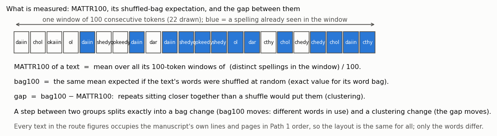

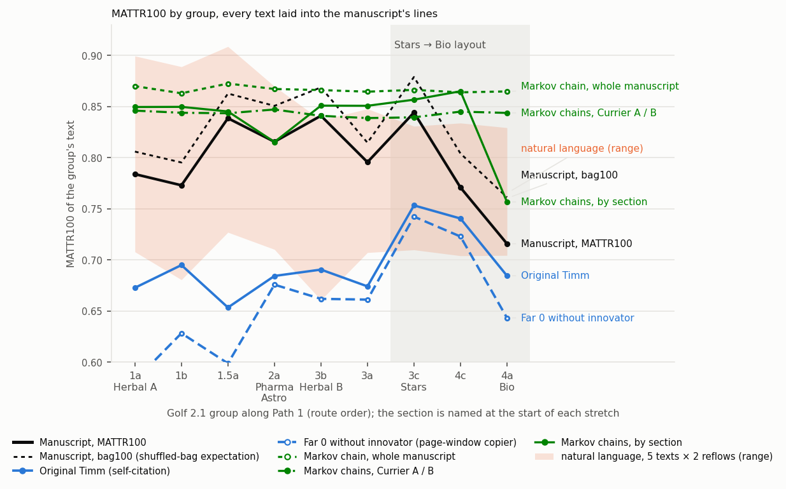

**Each historical text on its own (`prose_route.py`, user's question, 27 October).** The natural-language band of the chart above hides whether the texts move with the manuscript, rising into Stars and falling into Bio, or fluctuate on their own. Drawn one by one (five texts, two reflows each; MATTR100 of the text that lands in each group):

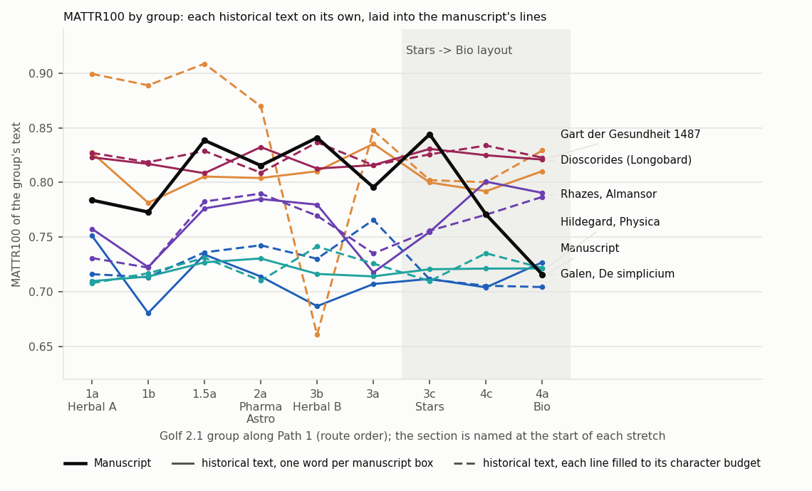

| Text | Reflow | 3b→3a | 3a→3c (into Stars) | 3c→4c | 4c→4a | 3c→4a (into Bio) | mean |step| over the route | Spearman with the manuscript (9 groups) |
|---|---|---:|---:|---:|---:|---:|---:|---:|
| Manuscript | | -0.045 | +0.049 | -0.073 | -0.055 | -0.128 | 0.043 | 1 |
| Galen, De simplicium | one word per manuscript box | +0.020 | +0.005 | -0.008 | +0.023 | +0.015 | 0.028 | +0.00 |
| Galen, De simplicium | each line filled to its character budget | +0.036 | -0.054 | -0.006 | -0.001 | -0.007 | 0.018 | +0.48 |
| Dioscorides (Longobard) | one word per manuscript box | +0.025 | -0.035 | -0.008 | +0.018 | +0.010 | 0.021 | +0.00 |
| Dioscorides (Longobard) | each line filled to its character budget | +0.187 | -0.046 | -0.002 | +0.029 | +0.027 | 0.068 | -0.08 |
| Rhazes, Almansor | one word per manuscript box | -0.062 | +0.037 | +0.046 | -0.010 | +0.036 | 0.032 | -0.33 |
| Rhazes, Almansor | each line filled to its character budget | -0.034 | +0.021 | +0.015 | +0.016 | +0.031 | 0.023 | +0.00 |
| Hildegard, Physica | one word per manuscript box | -0.002 | +0.007 | +0.001 | +0.000 | +0.001 | 0.006 | +0.10 |
| Hildegard, Physica | each line filled to its character budget | -0.016 | -0.016 | +0.025 | -0.014 | +0.012 | 0.018 | -0.02 |
| Gart der Gesundheit 1487 | one word per manuscript box | +0.003 | +0.015 | -0.006 | -0.004 | -0.010 | 0.011 | -0.10 |
| Gart der Gesundheit 1487 | each line filled to its character budget | -0.021 | +0.010 | +0.008 | -0.011 | -0.003 | 0.015 | +0.17 |

They fluctuate on their own. Of the ten series six rise into Stars and three fall into Bio (two do both), with mean steps of −0.006 and +0.011 where the manuscript's are +0.049 and −0.128; their steps between consecutive groups average 0.024 against the manuscript's 0.043, and of their 80 steps two are as large as the manuscript's fall into Bio and eight as large as its rise into Stars, none of them at those positions (the two large ones are one reflow of Dioscorides dropping to 0.661 at 3b, a repetitive stretch that the other reflow of the same text, a few hundred words displaced, does not meet). The two reflows of one text agree only where the text has a real long-range structure (Rhazes r +0.85; the others −0.37 to +0.05), different texts agree with each other at r +0.03 on average, and with the manuscript at a mean Spearman of +0.02. So the groups' token budgets impose no common shape on a text laid into them: the rise into Stars and the fall into Bio are the manuscript's, not the layout's, and a text that merely fluctuates produces steps half the manuscript's size with no preferred place.

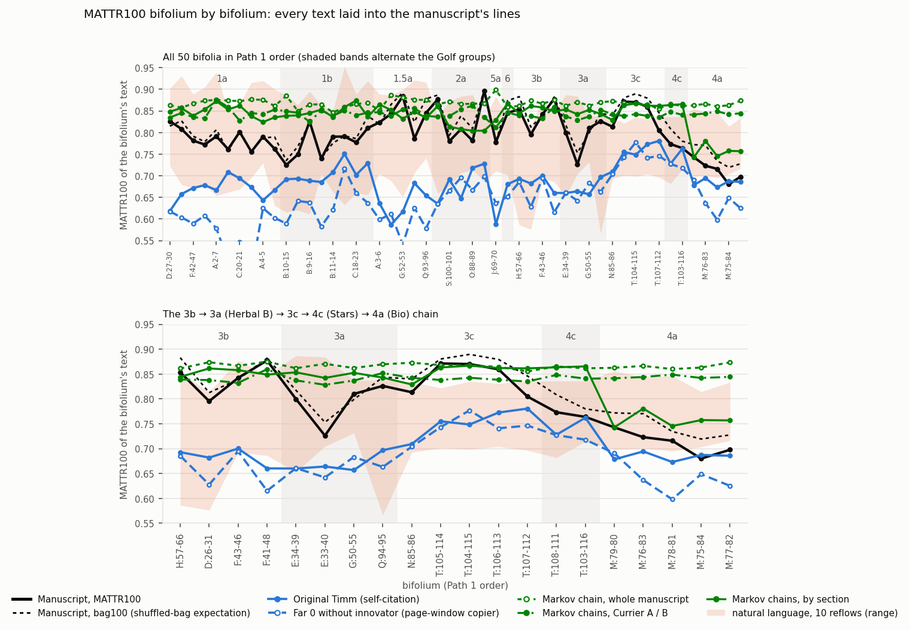

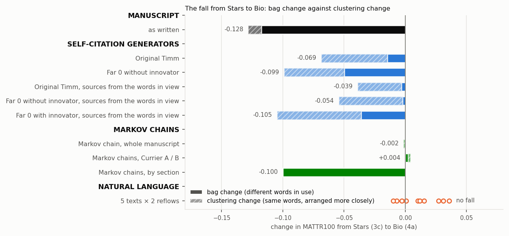

(`figures_small.py`; colour marks the class of text only: manuscript black, self-citation generators blue, Markov chains green, natural language orange. In the bifolium figure the manuscript's MATTR100 and its bag100 move together bifolium by bifolium inside the chain, E:33-40's dip and the 3c plateau included, while the page copiers rise in 3c and fall in 4a with the layout. The earlier composites `layout_controls.png` and `explained_mattr.png` are superseded.)

The gap (bag100 minus MATTR100, repeats beyond the bag) by group: manuscript 0.022 to 0.035 through 3c, 0.033 in 4c, 0.045 in Bio; Original Timm 0.053 in 3c to 0.107 in Bio, far 0 0.078 to 0.151, no-innovator 0.088 to 0.137; memory 0.031 to 0.018, pool 0.006 to −0.005; natural prose 0.03 to 0.10 and flat across the layout (Galen 0.070, 0.066, 0.067 in 3c, 4c, Bio; Hildegard 0.057, 0.045, 0.043; Gart 0.029, 0.035, 0.033); the Markov chains 0.00 to 0.01.

**Reading of the layout test.**

1. **The premise holds.** Natural prose reflowed into the manuscript's layout shows no fall in the Bio layout, under either reflow (3c → 4a −0.010 to +0.036; gap flat across the layout), and neither do the whole-manuscript and Currier chains (−0.002, +0.004). Every self-citation stream falls in the Bio layout (4c → 4a −0.042 to −0.105), and the page copiers fall by clustering: Original Timm's second step is the manuscript's size (−0.056 against −0.055) and is 91 percent clustering (−0.051 of −0.056); far 0's is −0.086 of −0.105. A layout-sensitive process collapses in this layout and a layout-insensitive one does not.
2. **The manuscript's fall is of the layout-insensitive kind.** It is 92 percent bag change (−0.118 of −0.128; clustering −0.011, inside the natural-prose range of −0.008 to +0.051). A Markov chain trained on each section's text and generated blind to the layout reproduces the fall into Bio as a pure bag change (3c 0.857, 4c 0.865, Bio 0.757; 3c → 4a −0.100 = −0.100 + 0.000), while the whole-manuscript and Currier chains, which carry no section composition, are flat. The layout-only generator misses the first step (−0.013 against −0.073), produces 0.015 of the manuscript's 0.118 bag change over the two steps, and puts the second step's size into the component the manuscript does not have. The manuscript's repeats beyond the bag (0.022 to 0.045) sit at the low end of natural prose (0.03 to 0.10) and at a third of the page copiers' (0.05 to 0.15), and their rise into Bio (+0.011) is a fifth of the copiers' (+0.05 to +0.07). A layout account of the Bio fall has to produce the manuscript's bag change without its missing clustering change. Under this layout the page copiers produce the clustering change at half to four fifths of their fall (Timm −0.054 of −0.069, the no-innovator far 0 run −0.049 of −0.099) together with a bag change of 0.015 to 0.050, because in a copier with mutation the bag is itself made by the copying and by how many words are in view (user's correction). The bag change alone therefore does not decide between composition and copying; the absent clustering change does, against copying from the page of the kind tested here.

**What the spatial statistic responds to (`component_strata.py`).** The section 7 statistic is taken apart on the same controls: word diversity of the words in view rises with the number of words the cone holds (Spearman +0.8 in every text) and pool size itself predicts repetition (the manuscript's pool-size contrast is −0.044: small pools at the top of a page carry fewer repeats), so the contrast is also taken inside pool-size tertiles; the manuscript is shuffled inside its paragraphs and inside its pages under the recorded rectangles; the same stretch of Galen is laid one word per box under the recorded rectangles and under synthetic rectangles proportional to its own words' lengths. Word impact throughout; one seed per generator; 200 bootstrap draws. The no-innovator far 0 row was added and the synthetic-rectangle rows recomputed after the overflow-placement correction (27 October).

| Lowest minus highest quintile, word impact | word diversity | components | pool size | word diversity inside pool-size tertiles (small, mid, large; mean) | components inside tertiles, mean | Bio, word diversity inside tertiles, mean |
|---|---:|---:|---:|---|---:|---:|
| Manuscript, recorded rectangles | +0.020 | +0.034 | −0.044 | +0.044, +0.075, +0.111; +0.077 | +0.061 | +0.041 |
| Manuscript shuffled inside paragraphs | −0.007 | +0.008 | −0.001 | +0.009, +0.002, +0.022; +0.011 | +0.021 | +0.040 |
| Manuscript shuffled inside pages | −0.011 | −0.006 | −0.013 | +0.001, −0.008, −0.011; −0.006 | +0.002 | −0.036 |
| Original Timm | +0.134 | +0.119 | +0.053 | +0.095, +0.155, +0.150; +0.133 | +0.104 | +0.182 |
| No-innovator far 0 | +0.087 | +0.114 | +0.014 | +0.102, +0.079, +0.110; +0.097 | +0.113 | +0.107 |
| Original Timm, sources from the words in view | +0.119 | +0.114 | +0.019 | +0.120, +0.145, +0.138; +0.134 | +0.120 | +0.124 |
| No-innovator far 0, sources from the words in view | +0.078 | +0.104 | −0.041 | +0.096, +0.120, +0.171; +0.129 | +0.137 | +0.120 |
| Far 0 with innovator, sources from the words in view | +0.062 | +0.107 | −0.051 | +0.078, +0.074, +0.144; +0.099 | +0.125 | +0.117 |
| Far 0 † | +0.100 | +0.137 | +0.027 | +0.111, +0.106, +0.095; +0.104 | +0.122 | +0.041 |
| 100-form memory † | +0.061 | +0.055 | +0.034 | +0.083, +0.053, +0.055; +0.064 | +0.052 | +0.086 |
| 2,000-token pool † | +0.090 | +0.093 | +0.064 | +0.078, +0.063, +0.048; +0.063 | +0.067 | +0.046 |
| Bigram chain, whole manuscript | −0.001 | +0.018 | +0.000 | −0.010, +0.010, −0.025; −0.008 | +0.020 | −0.004 |
| Bigram chains, Currier A and B | +0.004 | +0.018 | +0.010 | +0.000, +0.019, −0.028; −0.003 | +0.024 | +0.001 |
| Bigram chains, by section | −0.009 | +0.014 | −0.002 | −0.004, +0.002, +0.026; +0.008 | +0.015 | +0.001 |
| Galen, one word per box, recorded rectangles | +0.007 | −0.040 | −0.018 | −0.008, +0.019, +0.048; +0.020 | −0.046 | +0.018 |
| Galen, one word per box, synthetic rectangles | +0.102 | +0.017 | +0.001 | +0.073, +0.160, +0.167; +0.134 | +0.013 | +0.122 |

3. **Geometry.** The same prose in the same boxes gives +0.020 under the recorded rectangles and +0.134 under rectangles proportional to its own words' lengths (and +0.09 to +0.12 for the five texts in the character-budget reflow, which also uses synthetic rectangles). In a natural language the short words are the frequent ones; geometry coupled to word length turns that into the statistic, at the size of the page copiers'. The manuscript's recorded and synthetic rectangles differ by 0.017 on this measure, so its own boxes carry little of it, but the statistic cannot be read across texts without holding geometry fixed, and section 7's statement that natural prose "gives zero" holds under the recorded rectangles only.
4. **Order, not supply.** Held at fixed pool size, the manuscript's association is +0.077. It vanishes when the manuscript's words are shuffled inside their paragraphs (+0.011) or pages (−0.006): it is a property of the order of the words inside a paragraph, the local bursts of repetition, not of which words a paragraph or page uses. It is absent in natural prose under the recorded rectangles (Galen +0.020, the printed herbal −0.015) and in the three Markov chains (−0.008, −0.003, +0.008), matched in size by a printed herbal in its own lines (+0.078), a value traced below to word length, and is half to three quarters of the page copiers' (Original Timm +0.135, the no-innovator far 0 run +0.098). The manuscript shares with both copiers a within-paragraph burstiness that natural prose and Markov text lack (section 5 found the same in the body-line novelty fall, −0.050 raw against −0.006 shuffled), at half their size. In Bio (five bifolia, a noise floor of about 0.05) the manuscript's stratified value equals its paragraph-shuffled one (+0.041 against +0.040; the Markov chains −0.004 to +0.001), while both copiers stand well above it (Timm +0.182, the no-innovator far 0 run +0.107).
**A natural text in its own line structure (`native_layout.py`; construction corrected after the user's inspection).** The reflows above force natural prose into the manuscript's wraps. The Augsburg 1487 Gart der Gesundheit OCR keeps its printed lines (median 5 words and 31 characters), so it can be laid out physically in its own line structure. Each printed line is placed in one manuscript line slot in Path 1 order: it starts where the manuscript line starts, runs its own length at the page's character width (a short printed line is physically short), keeps the manuscript line's drawing gaps (a word that no longer fits before a drawing continues after it) and follows the recorded line's drift and height; OCR fragments (a single token of one or two letters, 404 lines) are dropped, over-long OCR lines are broken at word boundaries, and the 56 label-like slots (manuscript lines of at most two words and twelve characters, the single words beside the drawings on f84v, f75r, f83r) carry no printed line; three random starts. The construction was corrected four times on the user's inspection of the verification pages: a slot stretched across f77r by an oversized recorded box, one-letter OCR lines on f78v, offset blocks where the manuscript steps around drawings (f83r, f75v, f84v), drawing gaps filled straight through (f75r and 202 other lines), straight bands where the originals drift, and printed lines dropped onto label slots. Every synthetic layout now shares the same frame rules (`component_check.line_frames`, `lay_in_segments`). Its MATTR100 is flat across the layout (3c 0.818, 4c 0.818, Bio 0.824; 3c → 4a +0.005), as in the other two reflows (−0.010, +0.011). The spatial statistic in its own lines: components −0.004 and word diversity +0.056 over all tokens; inside pool-size tertiles +0.048, +0.099, +0.186 (mean +0.108 over three starts, +0.078 for the start shown on the app page; Bio +0.091); the same text one word per manuscript box −0.014, filled to the character budget +0.091. Numerically this matches the manuscript's +0.077. The first write-up read it as the association "at the manuscript's size"; the user challenged that, and the check below shows what the number is made of.

**What the printed herbal's value is made of (`mechanism_check.py`).** In German prose nearly half the tokens are words of three letters or fewer (47 percent; manuscript 18), and those are the repeats (Spearman of the target's length with its word impact −0.32; manuscript −0.22). Inside word-length classes the printed herbal's association disappears: the pool-size-stratified word-diversity contrast is +0.078 over all tokens, −0.082 for targets of three letters or fewer and −0.022 for targets of six or more; the same in the character-budget reflow (+0.087, −0.072, +0.010); nothing in any class under the recorded boxes (−0.015, −0.005, −0.002). The manuscript's survives the split (+0.077 overall, +0.044 and +0.045 in the two classes; with the oversized recorded boxes removed +0.077, +0.046, +0.043) and so do the page copiers' (Original Timm +0.135, +0.046, +0.088; the no-innovator far 0 run +0.098, +0.050, +0.032); the three Markov chains have none (whole +0.006, +0.021, +0.006; Currier +0.001, −0.017, +0.020; section −0.009, +0.028, −0.010). Excluding the 56 label-like slots as targets changes nothing (manuscript +0.077, Timm +0.135, no-innovator far 0 +0.099, character-budget Gart +0.087). The same split with H2, the conditional glyph entropy of the pool: manuscript +0.057 overall, +0.012 for short and +0.065 for long targets; Timm +0.084, +0.036, +0.043; the no-innovator far 0 run +0.070, +0.067, +0.038; the Markov chains +0.010, +0.025, −0.012 overall; Gart in its own lines +0.009 overall, −0.051 short, −0.005 long; and with component diversity: manuscript +0.061, +0.036, +0.051; Timm +0.107, +0.056, +0.063; the no-innovator far 0 run +0.115, +0.117, +0.045; Gart in its own lines +0.000, −0.086, +0.002. All three measures say the same thing. The likely route, not isolated further: under rectangles sized to the text's own words the pool depends on the target's length (the left reach is measured between word centres, so a short target admits more same-line neighbours, and in prose those are the short, repeated words), so the pool's diversity encodes the target's own length, and length predicts repetition; the pool's mean word length itself is nearly uncorrelated with its diversity (Spearman −0.04). The statement that the printed herbal "shows the association at the manuscript's size" is withdrawn: the number is similar, its content is the length composition of German prose read through length-coupled geometry, which the manuscript's value does not share. The user's expectation holds for both measures once the artefact is removed: natural text in its own layout has neither the MATTR fall nor a within-length-class association.

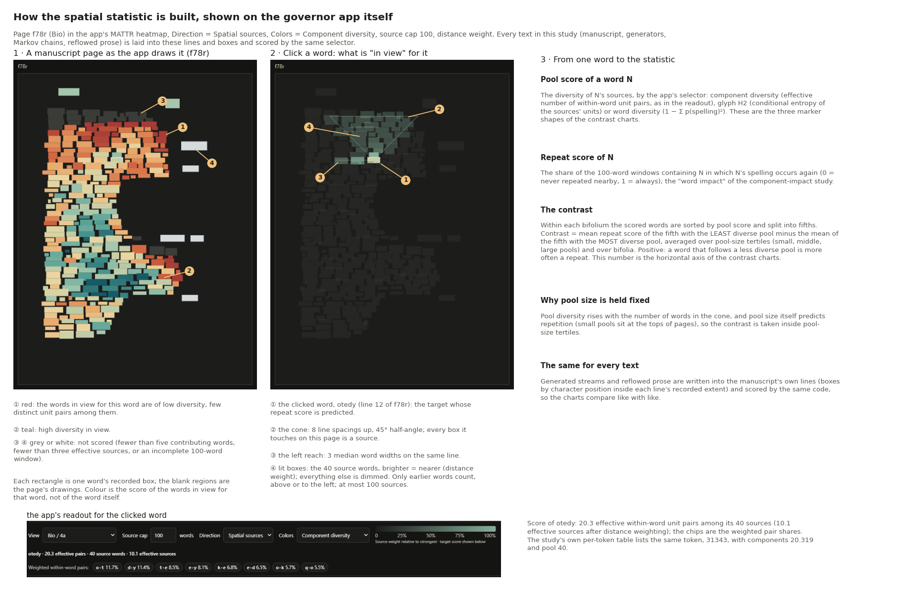

(An annotated infographic built from three captures of the governor app, at the user's request in place of a drawn schematic (`method_infographic.py`): page f78r as the app draws it in the Bio scope, the same page after the word otedy is clicked, with the cone (eight line spacings up, 45° half-angle), the left reach (three median word widths), the 40 lit source words shaded by distance weight, and the app's readout bar (20.3 effective within-word pairs, 40 source words, 10.1 effective sources, weighted pair shares), each element numbered and explained beneath; a third panel takes the reader from one word's pool score and repeat score to the quintile contrast that is the axis of the contrast charts. Captured from http://127.0.0.1:8765/heatmap.html with Direction = Spatial sources and Colors = Component diversity; the study's own token table lists the same token, 31343, with components 20.319 and pool 40.)


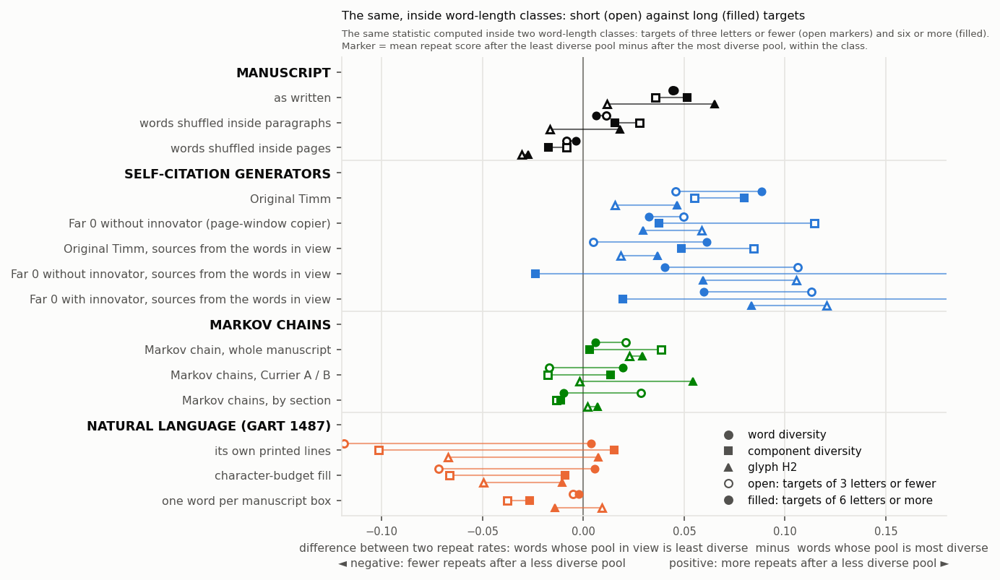

**The same statistic section by section (`mechanism_check.py`, user's request, 27 October).** The pool-size-stratified contrast computed inside each section, Herbal split by Currier language, for the six groups with 2,000 manuscript tokens or more (manuscript words scored in parentheses; the generators' and reflowed texts' counts differ slightly). Each cell is word diversity / components / H2.

| Pool-size-stratified contrast, word diversity / components / H2 | Herbal A (2,633) | Herbal B (1,570) | Pharma (1,186) | Stars (9,279) | Bio (4,917) | Text-only pages (1,696) |
|---|---:|---:|---:|---:|---:|---:|
| Manuscript | +0.107 / +0.063 / +0.040 | +0.084 / -0.003 / +0.009 | +0.077 / +0.027 / +0.036 | +0.087 / +0.076 / +0.058 | +0.053 / +0.052 / +0.066 | +0.099 / +0.121 / +0.111 |
| Manuscript, words shuffled inside paragraphs | +0.024 / +0.004 / +0.015 | -0.030 / +0.016 / -0.030 | -0.054 / -0.027 / -0.000 | +0.011 / +0.013 / +0.011 | +0.044 / +0.035 / -0.006 | +0.021 / +0.015 / +0.049 |
| Manuscript, words shuffled inside pages | -0.011 / +0.046 / +0.041 | -0.038 / +0.009 / +0.003 | -0.049 / +0.042 / +0.076 | +0.005 / +0.001 / -0.001 | -0.028 / -0.032 / -0.040 | -0.053 / +0.001 / +0.025 |
| Original Timm | +0.057 / +0.030 / +0.063 | +0.155 / +0.114 / +0.071 | +0.074 / -0.015 / -0.075 | +0.160 / +0.113 / +0.098 | +0.179 / +0.140 / +0.078 | +0.150 / +0.120 / +0.091 |
| No-innovator far 0 | +0.096 / +0.092 / +0.057 | +0.065 / +0.115 / +0.070 | +0.090 / +0.113 / +0.044 | +0.091 / +0.117 / +0.091 | +0.104 / +0.089 / +0.036 | +0.152 / +0.128 / +0.060 |
| Original Timm, sources from the words in view | +0.119 / +0.121 / +0.021 | +0.082 / +0.103 / +0.052 | +0.095 / +0.094 / +0.076 | +0.147 / +0.125 / +0.084 | +0.103 / +0.088 / +0.024 | +0.185 / +0.135 / +0.105 |
| No-innovator far 0, sources from the words in view | +0.128 / +0.165 / +0.109 | +0.148 / +0.158 / +0.118 | +0.103 / +0.140 / +0.101 | +0.148 / +0.151 / +0.102 | +0.114 / +0.109 / +0.113 | +0.081 / +0.117 / +0.114 |
| Far 0 with innovator, sources from the words in view | +0.078 / +0.145 / +0.113 | +0.092 / +0.106 / -0.005 | +0.155 / +0.194 / +0.089 | +0.120 / +0.136 / +0.115 | +0.103 / +0.128 / +0.081 | +0.131 / +0.149 / +0.102 |
| Markov chain, whole manuscript | -0.010 / +0.005 / -0.028 | -0.032 / +0.009 / -0.033 | -0.025 / +0.003 / +0.002 | +0.019 / +0.032 / +0.021 | +0.010 / +0.008 / +0.020 | -0.006 / +0.021 / -0.033 |
| Markov chains, Currier A and B | -0.040 / -0.045 / -0.035 | -0.007 / +0.032 / +0.027 | -0.021 / -0.022 / -0.022 | +0.005 / +0.033 / +0.062 | -0.009 / -0.031 / -0.014 | +0.046 / +0.046 / +0.039 |
| Markov chains, by section | +0.006 / -0.003 / -0.020 | +0.037 / +0.038 / -0.019 | -0.012 / -0.024 / -0.048 | -0.015 / +0.002 / +0.008 | -0.021 / -0.034 / -0.019 | +0.006 / -0.005 / +0.004 |
| Gart 1487, its own printed lines | +0.124 / +0.007 / +0.064 | +0.031 / -0.064 / -0.060 | +0.065 / -0.001 / +0.031 | +0.109 / +0.015 / +0.027 | +0.049 / +0.023 / +0.029 | +0.093 / +0.010 / +0.021 |
| Gart 1487, character-budget fill | +0.083 / -0.001 / +0.025 | +0.029 / -0.046 / -0.016 | +0.091 / -0.012 / -0.012 | +0.098 / +0.001 / +0.016 | +0.107 / +0.034 / +0.052 | +0.123 / +0.008 / +0.008 |
| Gart 1487, one word per manuscript box | -0.008 / -0.049 / -0.003 | -0.049 / -0.107 / -0.062 | +0.081 / -0.072 / +0.001 | -0.010 / -0.061 / -0.029 | -0.024 / -0.072 / -0.035 | +0.002 / -0.067 / -0.034 |

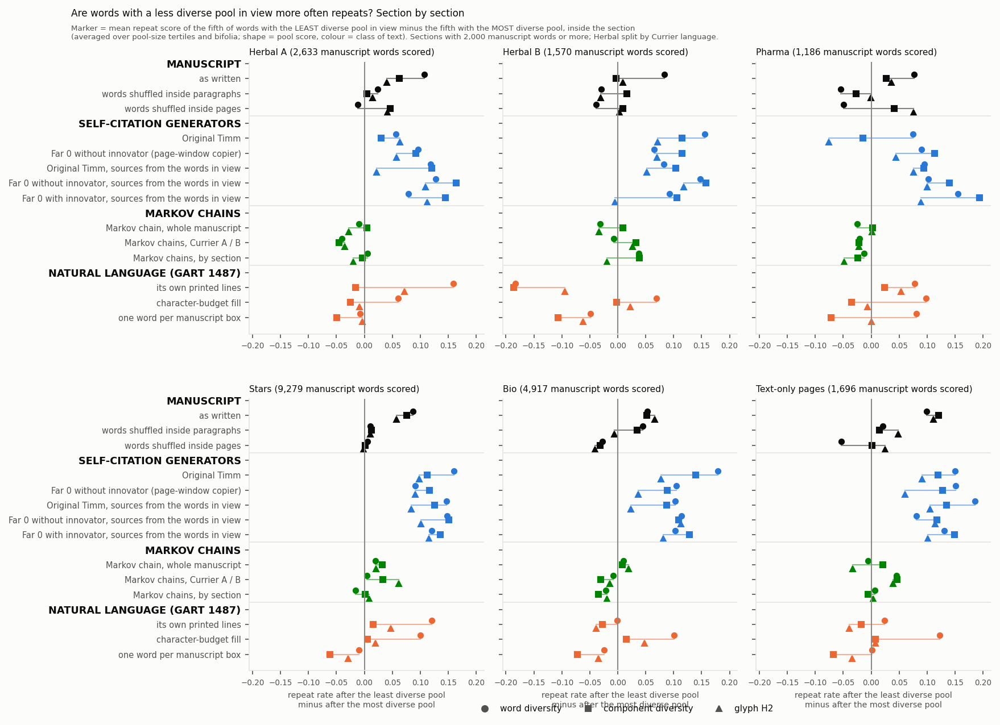

**Reading of the section split.** The manuscript carries the association in every section on word diversity (+0.05 in Bio to +0.11 in Herbal A); on components and H2 it carries it in Herbal A, Stars, Bio and the text-only pages and not in Herbal B or Pharma (−0.003 and +0.027 on components). In Stars, the one section large enough to shuffle cleanly, both shuffles remove it on all three scores (+0.01 and 0.00). In Bio the paragraph shuffle leaves +0.044 on word diversity and +0.035 on components against the manuscript's +0.053 and +0.052, and −0.006 on H2 against +0.066; in the sections of 1,200 to 2,600 scored words the shuffled values scatter between −0.05 and +0.08, the noise floor of the measure there. The copiers are not uniformly above the manuscript section by section. In Bio and the text-only pages they are two to four times its size on every score (Timm +0.192 and +0.150 against +0.053 and +0.099 on word diversity). In Stars the manuscript equals the no-innovator far 0 run on word diversity (+0.087 against +0.089) and stands at two thirds of both copiers on components (+0.076 against +0.113 and +0.115). In Herbal A it is above Original Timm on all three scores (+0.107 against +0.055 on word diversity; Timm's pool on the short Herbal pages holds little) and at the governed copier's level on word diversity (+0.121). The Markov chains stay within ±0.06 of zero in every section, and the German text repeats its pattern in every section: word diversity only, in its own lines and in the character-budget fill (the word-length artefact above), nothing or negative values in one word per box. What the split adds to the whole-manuscript reading: relative to the copiers the manuscript's association is largest in Herbal A and Stars and smallest in Bio, the section whose MATTR fall this study set out to explain, where the copiers show it at three to four times the manuscript's size and the manuscript's word-diversity and component values are within 0.02 of their paragraph-shuffled controls. (The Bio column of the strata table above is defined by Golf group 4a, this one by the section letter, so the two differ slightly.)

**The same statistic by Golf 2.1 group (`mechanism_check.py`, user's request, 27 October).** The pool-size-stratified contrast inside each of the nine groups in Path 1 order (manuscript words scored in parentheses). Cells are component diversity / H2; the word-diversity values are in `mechanism_check.json`. Two charts: the nine groups, and the whole-manuscript contrast chart, both drawn with component diversity and H2 only, as the user asked; the three-score versions stay beside them.

| Pool-size-stratified contrast by Golf 2.1 group, components / H2 (word diversity in the JSON) | 1a Herbal A (1,192) | 1b Herbal A (690) | 1.5a Herbal A (679) | 2a Pharma, Astro (1,459) | 3b Herbal B (857) | 3a Herbal B (889) | 3c Stars (7,253) | 4c Stars (3,263) | 4a Bio (5,353) |
|---|---:|---:|---:|---:|---:|---:|---:|---:|---:|
| Manuscript | +0.093 / +0.079 | +0.017 / +0.055 | +0.061 / +0.039 | +0.047 / +0.046 | +0.087 / +0.048 | -0.030 / -0.020 | +0.097 / +0.059 | +0.068 / +0.081 | +0.047 / +0.056 |
| Manuscript, words shuffled inside paragraphs | +0.005 / -0.057 | -0.004 / +0.002 | -0.010 / +0.070 | +0.009 / -0.009 | +0.024 / +0.037 | +0.017 / -0.030 | +0.018 / +0.016 | +0.022 / +0.045 | +0.026 / -0.010 |
| Manuscript, words shuffled inside pages | +0.075 / +0.041 | +0.088 / +0.093 | -0.035 / -0.028 | +0.044 / +0.059 | +0.031 / +0.071 | -0.010 / -0.040 | -0.003 / -0.008 | -0.006 / +0.016 | -0.029 / -0.032 |
| Original Timm | +0.073 / +0.044 | +0.027 / +0.003 | +0.092 / +0.139 | -0.005 / -0.066 | +0.054 / +0.040 | +0.156 / +0.109 | +0.112 / +0.095 | +0.124 / +0.084 | +0.142 / +0.078 |
| No-innovator far 0 | +0.100 / +0.070 | +0.084 / +0.077 | +0.069 / +0.059 | +0.106 / +0.055 | +0.146 / +0.063 | +0.141 / +0.068 | +0.118 / +0.083 | +0.064 / +0.038 | +0.093 / +0.051 |
| Original Timm, sources from the words in view | +0.088 / +0.053 | +0.128 / +0.010 | +0.082 / -0.014 | +0.090 / +0.065 | +0.038 / +0.003 | +0.175 / +0.058 | +0.119 / +0.093 | +0.159 / +0.076 | +0.107 / +0.030 |
| No-innovator far 0, sources from the words in view | +0.122 / +0.094 | +0.224 / +0.156 | +0.101 / +0.194 | +0.149 / +0.086 | +0.169 / +0.145 | +0.144 / +0.095 | +0.135 / +0.104 | +0.151 / +0.102 | +0.114 / +0.107 |
| Far 0 with innovator, sources from the words in view | +0.131 / +0.067 | +0.072 / +0.040 | +0.212 / +0.160 | +0.203 / +0.127 | +0.125 / +0.009 | +0.097 / +0.020 | +0.128 / +0.106 | +0.181 / +0.155 | +0.136 / +0.085 |
| Markov chain, whole manuscript | +0.023 / -0.001 | -0.009 / -0.005 | +0.012 / -0.022 | -0.016 / -0.016 | +0.055 / +0.002 | -0.018 / -0.002 | +0.026 / +0.005 | +0.056 / +0.054 | +0.005 / +0.018 |
| Markov chains, Currier A and B | -0.028 / -0.048 | -0.062 / -0.029 | +0.043 / -0.010 | -0.010 / -0.020 | -0.004 / +0.072 | +0.010 / +0.017 | +0.042 / +0.056 | +0.007 / +0.047 | -0.014 / -0.006 |
| Markov chains, by section | +0.045 / +0.048 | -0.010 / -0.086 | -0.026 / -0.093 | -0.005 / -0.011 | +0.009 / -0.056 | +0.019 / -0.030 | +0.007 / -0.001 | -0.008 / -0.003 | -0.024 / -0.011 |
| Gart 1487, its own printed lines | +0.052 / +0.047 | +nan / +nan | -0.166 / -0.022 | +0.002 / +0.017 | +nan / +nan | -0.019 / -0.065 | +0.026 / +0.014 | +0.016 / +0.039 | +0.008 / +0.006 |
| Gart 1487, character-budget fill | -0.075 / -0.027 | +0.053 / +0.087 | +0.033 / -0.030 | -0.008 / -0.003 | -0.007 / +0.025 | -0.025 / -0.054 | +0.013 / +0.011 | -0.007 / +0.011 | +0.030 / +0.058 |
| Gart 1487, one word per manuscript box | -0.082 / -0.035 | -0.018 / +0.076 | -0.011 / -0.005 | -0.056 / +0.021 | -0.051 / -0.042 | -0.119 / -0.057 | -0.075 / -0.045 | -0.030 / -0.000 | -0.083 / -0.032 |


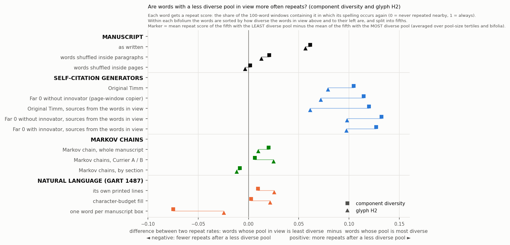

(`contrast_by_group.png` carries all three scores.)

**By manuscript / illustration section (28 October).** `summary_figures/build_illustration_contrasts.py` regroups the same target-level measurements by each page's `section` label in `physical_map.csv`, splitting Herbal into Currier A and B and combining Currier labels in the other sections. It retains the original chart's text samples, legacy geometry, full-window cohort, within-bifolium quintiles and three pool-size bands. This is not an average of Golf-group estimates. The script checks the existing Golf and section/Currier estimates before saving the new grouping, and confirms that all non-Herbal section results are unchanged.

| Illustration section | Scored manuscript words | Component contrast | H2 contrast |
|---|---:|---:|---:|
| Herbal A | 2,633 | +0.063 | +0.040 |
| Herbal B | 1,570 | -0.003 | +0.009 |
| Pharma | 1,186 | +0.027 | +0.036 |
| Stars (all Currier labels) | 9,854 | +0.079 | +0.062 |
| Bio | 4,917 | +0.052 | +0.066 |
| Text-only pages (all Currier labels) | 1,803 | +0.129 | +0.113 |
| Cosmological | 172 | +0.202 | -0.059 |
| Astrological | 75 | unavailable | unavailable |

The Cosmological estimate has only one contributing bifolium in each band. Astrological pages cannot supply the minimum 25 eligible targets per bifolium in every band, so no combined estimate is plotted. The one Herbal page without a Currier assignment, f65v, has no eligible manuscript targets and is retained separately in the data. The compact [metrics](summary_figures/illustration_contrasts.json) preserve page assignments, counts, band support, input hashes and reproduction checks for every control. No text generation was rerun; temporary per-token measurements were discarded.


**Reading of the group split.** Only three groups are large enough to read against their own shuffled controls: 3c (7,253 scored manuscript words), 4a (5,353) and 4c (3,263). There the manuscript shows the association on both scores (components / H2: 3c +0.097 / +0.059, 4c +0.068 / +0.081, 4a +0.047 / +0.056), the paragraph shuffle brings it to about +0.02 (3c +0.018 / +0.016, 4a +0.026 / −0.010; 4c keeps +0.045 on H2), and both copiers stand above the manuscript (components: 3c +0.112 and +0.118, 4c +0.124 and +0.064, 4a +0.142 and +0.093). In the six groups with 680 to 1,460 scored words the shuffled controls themselves move by up to 0.07 (1a shuffled inside pages +0.070 on components, 1.5a shuffled inside paragraphs +0.070 on H2), so values below that are noise there; within that noise the manuscript is at the copiers' level in 1a (+0.093 / +0.079 against +0.073 and +0.100), near zero in 1b, 2a and 3a (3a −0.030 / −0.020 where the copiers give +0.141 to +0.156), and the Markov chains move by up to ±0.09. Along the route, then, the statement of the whole-manuscript chart holds where it can be tested, in the three late groups: a within-paragraph association at half to two thirds of the page copiers' on component diversity, removed by the paragraph shuffle.


(`figures_small.py`. The horizontal axis of the two contrast charts is a difference between two repeat rates, which is why it can be negative. Each word's repeat score is the share of the 100-word windows containing it in which its spelling occurs again; within each bifolium the words are split into fifths by the diversity of the words in view above and to their left; the marker is the mean repeat score of the fifth with the least diverse pool minus that of the fifth with the most diverse pool, averaged over pool-size tertiles and bifolia. Positive: a word following a less diverse pool is more often a repeat; negative: less often. Marker shape is the pool score, colour the class of text. The coupling chart shows the texts only; the manuscript's shuffled controls, which couple exactly as the manuscript does, are in the table above it. `explained_spatial.png` is superseded.)

**Comparison page and two-page graphic (`compare_site.py`, `figures_pages2.py`).** `heatmap_variants/compare.html` (served with the variants, http://127.0.0.1:8766/compare.html) lets the reader pick any of the 50 bifolia and shows the twelve text versions of that sheet as columns (nine before the three spatial copiers were added), the sheet's pages as rows, in the app's design, each word box coloured by glyph H2, component diversity, source word diversity or MATTR, with the app's palette (the manuscript appears once, with its recorded boxes); the scores are precomputed with the app's selector, and the colour range is either shared across the texts of one unit system (Voynich glyph units; letters for the German text), so levels compare, or each text's own 5th to 95th percentile, as the app does. `pages_f75r_f116r.png` shows f75r (Bio) and f116r (Stars) under the nine versions as columns, coloured by glyph H2 and by component diversity, one colour range per measure shared by all columns (the German columns are scored on letters, so their panels are read for their within-page pattern, not against the Voynichese columns' level). An earlier build coloured the far 0 run with the innovator on and stacked each page's carried-over words under the last transcribed slot, which on f75r is a one-word line beside the drawing, so they ran down the page in a column (the user's observation); the overflow now goes below the page's lowest recorded line in its widest line's segments, and the self-citation columns are Original Timm and the no-innovator far 0 run. What the eye picks up there is the manuscript's within-page structure (on f75r the lower half of the text, on f116r horizontal bands) and the page copier's, against the structureless colouring of the Markov chains and the German text.

**The copier on the page's real geometry (`governor.py --spatial`, user's request, 27 October).** Until here every self-citation stream was written with Timm's own source draw, a line uniform among the page's lines so far and a same-column bonus, and only laid into the manuscript's lines afterwards; the layout entered the generator through the lines' lengths alone. At the user's request the generator was given the page itself: `--spatial` replaces Timm's page draw by the app's spatial selector run on the recorded word rectangles of the page being written (the cone eight line spacings above the word, the reach three word widths to its left, weight alignment / (1 + distance)², the same `heatmap_sources.js` rule as every table here), with the generated words laid into the lines by one implementation shared with this study (`page_geometry.py`, which `component_check.py` now imports), so that the geometry the generator draws from is the geometry the scorer puts under its text (the generator's pools are 1.4 to 1.7 words smaller than the scorer's on the finished stream, identical in size for a fifth of the tokens and within two words for two thirds, because the page's word width and pitch are taken from the recorded boxes rather than from the stream's own). The selector port is identical to the JavaScript on all 34,912 manuscript tokens with a box and the layout identical box for box to this study's synthetic geometry (`page_geometry_check.py`). Three configurations ran, three seeds each: Original Timm with the spatial draw, the no-innovator far 0 configuration with it, and, brought back at the user's request in this form, the far 0 configuration with the innovator (`runs/p_timm_spatial*`, `p_noinnov_spatial*`, `p_far0_spatial*`; the generator's own account, scores and source statistics are section 39 of `research/dynamic_selfcitation_20261024/governed/RESULTS.md`). About 71 to 73 percent of the tokens inside the manuscript's 4,130 lines took their source from the words in view (the rest are Timm's paragraph-initial, suggestion and random draws and the page-first words with nothing in view); a word had 22 to 24 words in view; 15 percent of the sources came from the same line to the left, 23 percent from the line directly above, the rest from higher lines, against 30 percent from the line directly above and none from the same line under Timm's own rule.

**The layout itself was corrected first.** Checking the verification pages, the user found f29r's text written across the plant's stem: the frame rule split a line only at gaps wider than twice the page's median word width, and the stem's gap (44 to 98 units on lines 3 to 8, against a median word of 62) fell under it. The rule now also splits at the vertical gaps that neighbouring lines share (`page_geometry.vertical_gaps`: gaps wider than half the median word width whose x-intervals overlap on lines at most two apart); it cuts 570 of the 4,130 lines on 91 pages, the stems and diagram columns of the Herbal and Pharma pages and a few Stars margins, at a median gap of 1.3 word widths. Every synthetic layout, every table of sections 7 and 8 and the generator's own view of the page were rebuilt with it; the numbers move by at most 0.01 (Original Timm's component contrast from +0.119 to +0.115, the no-innovator far 0 run's from +0.120 to +0.118, the manuscript's recorded-box values not at all).

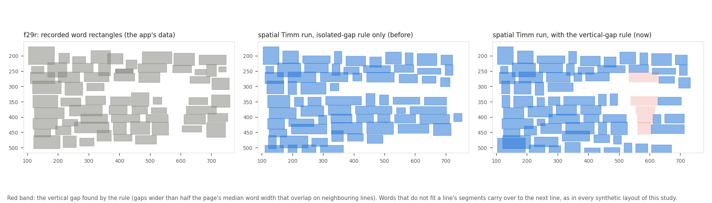

**What the real geometry changes.** The three spatial copiers appear in every table above (rows "sources from the words in view") and in `route_mattr_spatial.png`:

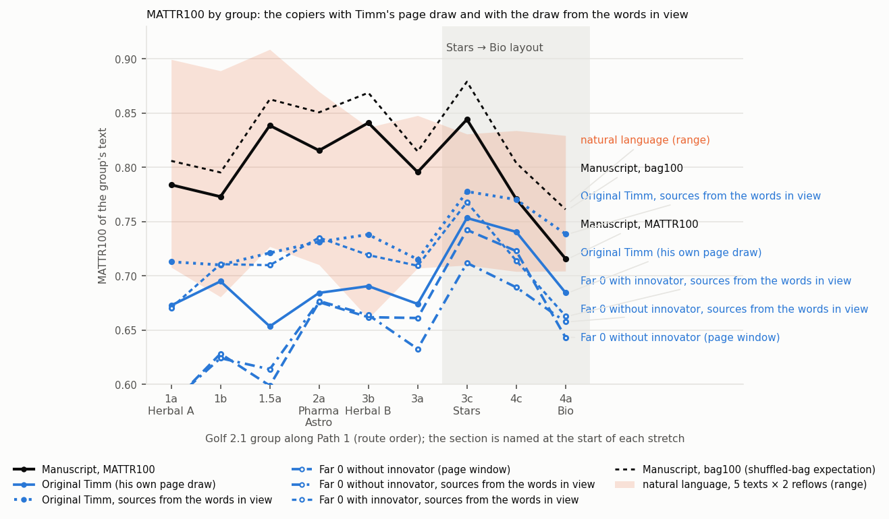

| | Manuscript | Original Timm | Timm, words in view | No-innovator far 0 | No-innovator, words in view | Far 0 with innovator † | Far 0 with innovator, words in view |
|---|---:|---:|---:|---:|---:|---:|---:|
| MATTR100 fall 3c → 4a = bag + clustering | −0.128 = −0.118 − 0.011 | −0.069 = −0.015 − 0.054 | −0.040 = −0.003 − 0.036 | −0.099 = −0.050 − 0.049 | −0.054 = −0.002 − 0.052 | −0.135 = −0.063 − 0.073 | −0.105 = −0.036 − 0.069 |
| clustering beyond the bag in 4a (bag100 − MATTR100) | 0.045 | 0.107 | 0.106 | 0.137 | 0.145 | 0.151 | 0.166 |
| local concentration: bifolium / page / within-page (section 2) | 0.012 / 0.008 / 0.009 | 0.029 / 0.064 / 0.004 | 0.021 / 0.055 / 0.022 | 0.021 / 0.064 / 0.030 | 0.016 / 0.052 / 0.048 | 0.023 / 0.063 / 0.029 | 0.021 / 0.063 / 0.049 |
| spatial contrast, components, all / Bio (section 7) | +0.034 / +0.021 | +0.115 / +0.140 | +0.111 / +0.111 | +0.118 / +0.122 | +0.097 / +0.073 | +0.130 / +0.104 | +0.091 / +0.080 |
| pool-size-stratified contrast, word div. / comp. / H2 | +0.077 / +0.061 / +0.057 | +0.135 / +0.105 / +0.079 | +0.135 / +0.120 / +0.061 | +0.098 / +0.114 / +0.072 | +0.124 / +0.132 / +0.098 | † | +0.100 / +0.127 / +0.097 |
| Bio strata, word diversity | +0.041 | +0.182 | +0.124 | +0.107 | +0.120 | +0.051 | +0.117 |
| MATTR colour ~ components, token / page means | +0.26 / +0.48 | +0.35 / +0.69 | +0.32 / +0.70 | +0.42 / +0.77 | +0.30 / +0.62 | † | +0.20 / +0.60 |
| Bio anchors surviving the own-paragraph shuffle (section 5) | 0.86 | 0.53 | 0.52 | 0.46 | 0.48 | 0.48 | 0.57 |
| page-boundary penalty, lags 1–50: Herbal / Bio / Stars (section 6) | 0.86 / 0.60 / 0.91 | 0.50 / 0.72 / 0.86 | 0.38 / 0.54 / 0.61 | 0.47 / 0.35 / 0.54 | 0.44 / 0.16 / 0.11 | 0.43 / 0.24 / 0.50 | 0.30 / 0.13 / 0.13 |
| Bio page opening: novelty at words 1–9 / 100+ (section 6) | 0.70 / 0.58 | 0.62 / 0.54 | 0.69 / 0.61 | 0.75 / 0.51 | 0.78 / 0.52 | 0.80 / 0.53 | 0.83 / 0.53 |
| immediate repeats inside Herbal pages, lag 1 over the page-shuffle expectation | 1.06 | 0.84 | 1.28 | 0.87 | 1.28 | – | 1.29 |

(† the innovator-on far 0 run with Timm's draw stays out of the figures as before; its spatial version is in them at the user's request. Sources: `layout_controls.log`, `scales.log`, `component_check.log`, `mechanism_check.log`, `component_strata.log`, `mattr_vs_components.log`, `shuffle_check.log`, `continuity.log`, `pagestart.log`.)

Reading. (1) The real geometry does not bring the copiers' route closer to the manuscript's; it takes them further from its kind of change. With Timm's own draw the copiers' fall into Bio was already mostly clustering; with the words in view as the supply the bag part of the innovator-free copiers' fall disappears (−0.003 and −0.002 against the manuscript's −0.118) and what is left is clustering alone, −0.036 and −0.052, the component the manuscript lacks (−0.011). The innovator-on configuration keeps a bag part (−0.036) because its innovator moves the bag, and its fall (−0.105) is the one nearest the manuscript's size, with a clustering part six times the manuscript's. (2) The real geometry moves the copiers' concentration into the page. Timm's within-page component rises from 0.004 to 0.022 (the manuscript's is 0.009) and the governed copiers' to 0.048 and 0.049, while the page and bifolium components fall; the immediate repeats that the left reach produces (lag 1 at 1.28 to 1.29 times the shuffle expectation in Herbal, where the manuscript has 1.06) are the most visible sign of it. (3) The spatial component association does not move toward the manuscript: components +0.111, +0.097 and +0.091 against +0.034 (Timm's own draw +0.115), still three times the manuscript's; held at fixed pool size +0.120 to +0.132 against +0.061; the coupling of the MATTR colour with the pool's diversity stays at the copiers' level (+0.60 to +0.70 between page means) and the within-paragraph shuffle test is unchanged (0.48 to 0.57 of the Bio anchors survive, the manuscript's 0.86). (4) The page boundary becomes a wall. A copier that can only see the page it is writing loses 56 to 70 percent of its re-use across the Herbal boundary (the manuscript 14 percent) and 84 to 89 percent across the Bio and Stars boundaries under the governor's pressures, where the manuscript loses 9 to 40; Timm's own window, which reaches the previous page's last line at a page's start, kept the boundary half-transparent. (5) One thing does move toward the manuscript: with the words in view Timm's Bio page opens as the manuscript's does, novelty 0.69 at words 1 to 9 falling to 0.61 in the page's body (manuscript 0.70 to 0.58, Timm's own draw 0.62 to 0.54), because the spatial copier's supply on a fresh page is small and local and his checks reject its repeats; the governed spatial copiers open starved (0.78 to 0.83) and recycle (0.52 to 0.53) as the page-window copiers did. So wiring the true spatial layout into Timm's draw changes the generator in the way the question anticipated, more local repeats, a page-bound text, and it answers the question the same way as before: the manuscript's MATTR drops are not the collapses a copier of the page produces, with Timm's draw or with the page's real geometry; the spatial copiers' falls are clustering where the manuscript's is a bag change, their boundaries are walls where the manuscript's Herbal boundary is transparent, and their within-page clustering is three to five times the manuscript's.

**Verification pages in the app's own format (`heatmap_variants.py`).** At the user's request each of the layouts is written as a copy of the governor app's MATTR heatmap page whose word rectangles and data bundle are the experimental text's, with the app's scripts copied unchanged into `heatmap_variants/shell/`; the manuscript variant is the app's own data, and a `manuscript_clean` variant drops its oversized recorded rectangles, as every other recorded-box variant does (thirteen pages in all: the two manuscript pages, Original Timm, the no-innovator far 0 run, the three copiers whose sources come from the words in view, the three Markov chains and the three Gart layouts). Served with `python -m http.server 8766` in `heatmap_variants/` (index at http://127.0.0.1:8766/), a page such as http://127.0.0.1:8766/gart_own_lines/heatmap.html#scope=4a&window=100&direction=spatial&colors=components&left=3&depth=8&angle=45&weight=distance colours every word by the component score computed by the app's code and, on a click, draws the cone and the weighted pool. A CSV beside each page lists this study's per-token numbers for f78r. Cross-check on the final build (27 October, after the overflow correction): token 17695 ("sind", f78r line 16, Gart in its own lines) reads 32.6 effective pairs from 30 source words in the app and 32.610 and 30 in `gart_own_lines/f78r_tokens.csv`; the app's third figure for that word, 11.8 effective sources, is the effective number of weighted source words, which the CSV does not list (its `pair_ess`, 11.649, is the effective number of weighted pairs; an earlier version of this sentence set those two different statistics side by side); the app's Bio row means for that variant are 26.2 to 28.6 effective letter pairs. On f75r the Timm variant's rows show the central drawing gap (343 to 428 units) and the original vertical drift; on f84v the own-lines variant leaves the label column empty.

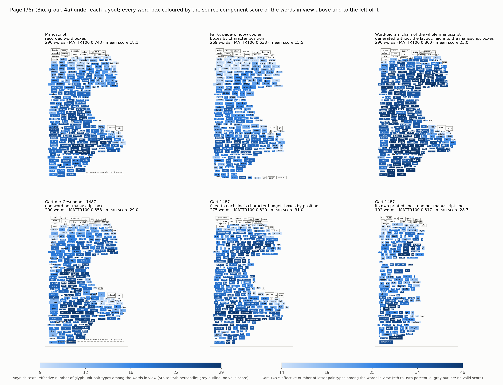

The page figure shows f78r (Bio) as each text lays it out, every box coloured by the source component score of the words in view above and to the left of it (two colour scales: glyph-unit pairs for the Voynich texts, letter pairs for Gart). The recorded word rectangles include a few oversized boxes (on f78r the token dar spans the whole text block; manuscript-wide 21 boxes are wider than six times, and 188 taller than two and a half times, the median); they enter the other study's cone selection as given and are drawn as dashed outlines here.

**What the eye compares on the pages (`mattr_vs_components.py`).** Switching the app's colours between MATTR and component diversity, the user saw the two track each other on the manuscript's pages and not on the natural text's. Measured as the Spearman correlation between the MATTR colour (distinct share of the backward 100-token window ending at the token) and the diversity of the words in view:

| Layout | token level: components, word diversity, H2 | within page: components, word diversity, H2 | page means (pages): components, word diversity, H2 | spread of page-mean MATTR |
|---|---|---|---|---:|
| Manuscript | +0.26, +0.06, +0.34 | +0.09, −0.02, +0.05 | (72) +0.48, +0.35, +0.72 | 0.062 |
| Manuscript, oversized recorded boxes removed | +0.26, +0.06, +0.34 | +0.09, −0.02, +0.05 | (71) +0.50, +0.35, +0.74 | 0.062 |
| Manuscript, words shuffled inside paragraphs | +0.26, +0.07, +0.34 | +0.10, +0.01, +0.06 | (72) +0.50, +0.31, +0.72 | 0.061 |
| Manuscript, words shuffled inside pages | +0.25, +0.06, +0.32 | +0.06, −0.01, +0.04 | (72) +0.51, +0.30, +0.70 | 0.060 |
| Original Timm (page copier) | +0.35, +0.15, +0.21 | +0.08, −0.05, +0.01 | (80) +0.69, +0.50, +0.45 | 0.055 |
| No-innovator far 0 (page-window copier) | +0.42, +0.15, +0.26 | +0.13, −0.04, +0.07 | (89) +0.77, +0.53, +0.63 | 0.078 |
| Original Timm, sources from the words in view | +0.32, +0.13, +0.18 | +0.09, −0.04, +0.01 | (78) +0.70, +0.55, +0.49 | 0.044 |
| No-innovator far 0, sources from the words in view | +0.30, +0.10, +0.20 | +0.08, −0.06, +0.06 | (90) +0.62, +0.36, +0.55 | 0.067 |
| Far 0 with innovator, sources from the words in view | +0.20, +0.02, +0.18 | +0.03, −0.06, +0.02 | (79) +0.60, +0.40, +0.60 | 0.067 |
| Markov chain, whole manuscript | +0.09, +0.02, +0.08 | +0.09, +0.02, +0.08 | (71) +0.18, +0.04, +0.12 | 0.020 |
| Markov chains, Currier A and B | +0.05, +0.01, +0.07 | +0.08, +0.03, +0.08 | (69) +0.04, −0.09, +0.11 | 0.022 |
| Markov chains, by section | +0.18, +0.04, +0.24 | +0.06, −0.00, +0.04 | (70) +0.66, +0.38, +0.72 | 0.050 |
| Gart 1487, one word per manuscript box | +0.06, +0.01, +0.04 | +0.05, +0.00, +0.04 | (70) +0.13, +0.11, +0.11 | 0.023 |
| Gart 1487, character-budget fill | +0.04, −0.01, +0.03 | +0.04, +0.00, +0.04 | (73) −0.03, −0.09, −0.05 | 0.027 |
| Gart 1487, its own printed lines | +0.01, −0.04, +0.00 | +0.01, −0.01, −0.00 | (51) +0.32, +0.22, +0.29 | 0.028 |

The observation is correct: in the manuscript the component diversity of the words in view tracks the local MATTR (token level +0.26, page means +0.48, mostly between pages), and in the natural text it does not (−0.00 to +0.06) under any of the three layouts. Two things produce the difference. Voynichese words are built from a small unit inventory with few pairs per word, so when the word types in view repeat, the pair types repeat and pair diversity follows type diversity; German letter-pair diversity saturates inside any pool of thirty words and is set by word length and spelling, not by repetition. And the manuscript's page-mean MATTR varies two to three times more than the prose's in these pages (0.062 against 0.023 to 0.027), because its vocabulary composition changes by bifolium and page (sections 2 and 6), so there is more between-page signal to correlate. What the coupling does not show is a page in view driving MATTR. The whole-manuscript and Currier chains, which carry no section composition, barely couple (+0.09 and +0.05 at token level; page means +0.18 and +0.04); the section-trained chain, which copies nothing and sees no page, couples at two thirds of the manuscript's token level and fully at page level (+0.18; page means +0.66, and with H2 +0.72 against the manuscript's +0.72); the page copiers couple more strongly than the manuscript at token level (Original Timm +0.35, the no-innovator far 0 run +0.42; page means +0.69 and +0.77). The manuscript's coupling is untouched by shuffling its words inside paragraphs (+0.26; page means +0.50) or inside pages (+0.25; +0.51): it is a property of which words each page uses, not of their order. The coupling appears as soon as a text carries section-level composition and not before. The visual difference between the manuscript's pages and the natural text's is the unit system and the regional composition, not the mechanism.

5. **For the question of this study.** The spatial association of section 7 is a within-paragraph order effect of half a copier's size that a layout-blind supply reproduces, and the MATTR fall into Bio is a bag change without a clustering change, which a layout-blind Markov chain reproduces and which no page copier here produces without a clustering change of the same size or larger. The layout test the user proposed confirms its premise and, applied to the manuscript, separates the two components: what collapses with the layout is clustering, and the manuscript's fall lacks that component. Whether its bag change was produced by composition or by a copying process whose supply is not the page cannot be decided here: the streams that would test the second (the 100-form memory and the 2,000-token pool) ran with the innovator on and are discarded.

## 9. Reading

The generators' MATTR collapses are page-local recycling events: a page window that shrinks at transitions, a concentrated draw, and a text that feeds on its own last lines until the archive or an outside supply breaks the loop. That mechanism leaves three fingerprints, and the manuscript has none of them.

1. **Scale.** Copying from the page as the saved generators do it concentrates vocabulary page by page, each page onto its own forms (Timm 0.064 of 0.098; far 0 0.067 of 0.118; group coverage flat while page coverage climbs, section 5). This component measures the drift of the dominant set between pages and so depends on the generators' mutation rate; it describes their falls and is not load-bearing against a slower-drifting copier. The manuscript's page-level concentration is 0.008, its total local structure 0.029, both inside the range of medieval prose laid into the same page structure (0.008 to 0.053).
2. **Kind of change.** Every manuscript step is a change of the word bag, the set of words in use; the clustering of repeats never moves by more than 0.013. The layout-only generator's matching falls are mostly clustering, it misses the 3c→4c fall and reverses the 1b→1.5a rise, and across the 50 bifolia its profile is unrelated to the manuscript's. In the two late steps the generator and the manuscript fall together, but not in the same way: the generator's pages each concentrate on their own forms (group coverage flat, page similarity falling), the manuscript's pages converge on one set (group coverage 32 to 49 percent, similarity rising; section 5). Inside pages the generators fall where each other fall (0.8 to 0.9 of anchors) and where the manuscript falls only slightly above chance (0.6 to 0.7 against 0.5, with unrelated prose cut into the same lines scoring 0.4 to 0.8); the manuscript's line-level fall series shares no variance with Timm's beyond the noise unrelated texts produce. Where both do fall, they fall by different kinds of event, and this does not depend on how any generator forms its words: the manuscript's largest within-page falls survive a shuffle inside its paragraphs (0.86) and every generator's fall to chance (0.46 to 0.57); the manuscript's Bio deficit is complete at the first ten tokens after a paragraph opening and uniform in depth, where every generator's is small there and grows with depth; and the manuscript's page vocabularies are organized by bifolium, not by the page written just before (section 5). Governed streams fall where the manuscript falls because their targets are the manuscript's composition.
3. **Sight and the page as a unit.** Pooled over the route a page in view does not raise the re-use of its words (same face against flip, null in 46 bifolia; the face-blind generators give the same null), and the page boundary costs Herbal and Stars re-use 9 to 14 percent against 22 to 54 in the generators; Herbal's transparent boundary joins, in 119 of 124 cases, two pages of one bifolium or of adjacent bifolia of one Golf 2.1 group, which share the vocabulary of their stretch of the chronology (page similarity falls with Path 1 distance in step with the fitted gradient), and no content is attributed to any Herbal form. Bio is different: its page boundary is a break of the generators' size (40 percent), its pages are vocabulary units, and two of its five co-visible transitions carry twice the within-page repeat rate across the fold (p 0.05 to 0.07 on five bifolia, no excess in whole-page sharing; an open lead, section 6). What distinguishes the manuscript's Bio page from a page-window copier's is its opening: new words first, then uniform use of its own vocabulary, where the copier starts starved and recycles.

So the availability of word templates on the page is not related to the manuscript's MATTR drops. The drops are what the positional composition model already describes: which words are in use changes along the route, and in Bio a few very frequent forms carry a large share of the text. If the text was composed by copying, the supply was not the page in front of the writer: the one generator whose scale profile resembles the manuscript's (bifolium 0.013, page 0.020, within 0.004 against 0.012, 0.008, 0.009) draws half its sources from a memory of the last hundred distinct forms, carries that memory across page boundaries, and gets its falls from the fitted composition (that stream ran with the innovator on, so this is a description of a profile, not a tested account). The manuscript's within-page clustering in Bio (0.022; f75r 0.055) is real and larger than in the memory and layout-only streams, but it is the size of such clustering in Latin medical prose (0.014 to 0.028 in the same slot), does not persist beyond a few tokens, and does not sit on the pages where the layout makes the generators collapse.

With the generator on the page's real geometry (section 8, the user's request), the three fingerprints are unchanged or sharper: the spatial copiers' falls into Bio are clustering with no bag part, their page boundaries are walls (the manuscript's Herbal boundary is transparent), and their within-page concentration is three to five times the manuscript's; and the historical texts, drawn one by one, show no common rise into Stars or fall into Bio, so those two steps are the manuscript's own and not the layout's.

**Status of the claims after five rounds (27 October).** Withdrawn or narrowed in this study's own revisions: (1) the convergence/divergence contrast and the page-level component of the scale decomposition were withdrawn as load-bearing; they measure between-page drift and depend on the generators' mutation rate (sections 2, 5). (2) The pooled boundary penalty of "0 to 13 percent" was Herbal's; in Bio the manuscript's page boundary is a break of the generators' size (section 6). (3) The pooled visibility null hid a Bio inner-face lead on two transitions (p 0.05 to 0.07), recorded as open (section 6). (4) "Shared Herbal register" and "plant-specific hapaxes" were withdrawn; the Herbal boundary is a boundary inside one bifolium or one stretch of the chronology (section 6). (5) "Template availability is not what moves the MATTR" is restated after the calibration of the component-impact association (section 7). (6) Section 7's "natural prose gives zero" held under the recorded rectangles only, and "at the edge of zero in Bio" was the unstratified value; both are restated in section 8, where the user's layout test (natural and bigram texts reflowed into the manuscript's lines) is run. (7) The printed herbal's own-lines value, first reported as the association "at the manuscript's size", is a word-length artefact of the instrument: it vanishes inside word-length classes, where the manuscript's survives (section 8). (8) The synthetic layouts carried construction defects the user found on the verification pages (slots stretched by oversized recorded boxes, one-letter OCR lines, drawing gaps filled straight through, straight bands over drifting lines, printed lines on label slots, and the manuscript's own oversized boxes in the recorded-box variants); all were rebuilt with one frame rule, every table in sections 7 and 8 was recomputed with the final rule (robust frames, drawing gaps, line drift, carry-over placement, cleaned recorded boxes, label slots) and the readings are unchanged (section 8). (9) The Markov control set is the three chains the user specified (whole manuscript, Currier A and B, section); the by-group chain, fitted to the Golf groups' own words, was not an independent channel and is out of the comparison. (10) H2 was added to every comparison: it behaves like component diversity and word diversity throughout. (11) The far 0 (`m_far0*`), 100-form memory and 2,000-token pool streams ran with the slot innovator on; at the user's direction they are out of the figures and the reading (rows marked †), and section 7's item 3, the association "equalled by streams that never take a word from the page", is withdrawn with them; the innovator-free generators are Original Timm and the no-innovator far 0 run. (12) The carry-over placement stacked a page's overflow under the last transcribed slot, which on f75r put a column of words down the page (user's observation); overflow now goes below the page's lowest line, and the spatial tables of sections 7 and 8, the verification pages and the page figures were recomputed. (13) The opening inference "composition, not copying collapses" was overstated (user's correction): a bag change is consistent with a copier with mutation whose supply changes, and the page copiers' own bags move; what the manuscript lacks is the clustering change and level that copying from the page produces (sections 2, 8). (14) The frame rule missed the vertical drawing gaps (the plant's stem on f29r, the user's observation); it now splits at the vertical gaps neighbouring lines share, every synthetic layout and every table of sections 7 and 8 was rebuilt with it, and the values moved by at most 0.01 (section 8). (15) The generator was given the page's real geometry (`governor.py --spatial`, the user's request): three copiers draw their sources from the words in view on the recorded rectangles; their falls into Bio are clustering without a bag part, their page boundaries walls, their concentration inside the page, and the spatial association unchanged, so the conclusion stands with the true spatial layout in the generator (section 8). The far 0 configuration with the innovator is back in the figures in its spatial form at the user's request. (16) The historical texts' route was drawn text by text (user's question): no common rise into Stars or fall into Bio, steps half the manuscript's size with no preferred place (section 8). (17) A forum reader proposed the mirror-cone direction test (28 October): the manuscript's association is the same read from the cone below N as from the cone above (paired difference +0.004, −0.019 to +0.026) where Original Timm's is +0.068; one copier of the words in view is itself nearly symmetric (+0.010), so the test separates the manuscript from Timm's generator, not from copying as such; two line-position controls show the association is not an edge-of-line effect (section 7, item 7). (18) The overlap test (user's request, 28 October): with the cone holding other lines only and twins inside it not counted, the manuscript's association falls to its paragraph shuffle's level while every copier keeps most of its own; the association of items 1 to 7 is N's own line, not the lines in view (section 7, item 8). Standing, and so far untouched by any check including that study's: every regional step is a change of the shuffled-bag expectation, 95 to 100 percent (section 2); the manuscript's largest within-page falls survive a shuffle inside its paragraphs where every generator's fall to chance (section 5); the Bio deficit is complete at the first tokens of a paragraph and uniform in depth (section 5); page vocabularies are organized by bifolium and by position on the chronology (sections 5, 6); the Bio page opens with new words where a page-window copier opens starved (section 6).

## 10. Limits

- Face and flip follow Path 1's page order within bifolia and the flat-sheet reading of a bifolium (inner face A verso with B recto). Within foliation order the same-face transitions are verso→recto and the flips recto→verso, so a recto/verso difference of register could in principle offset a visibility effect; the generators, which share the layout and would show any such layout-borne difference, show none, and the manuscript's difference is zero rather than merely small.
- Horizontal positions are transcription character positions, not the recorded word rectangles; the same-position instrument does not detect Timm's own bonus and is reported only as inconclusive.
- MATTR is a spelling measure; the manuscript's line-edge spelling registers inflate its novelty relative to the generators (the interior-only series falls the same way). The natural-language references are OCR-derived printed texts whose errors add spurious types; they bound the clustering gap from above if anything.
- Path 1 is the study's ordering, not an established chronology; all comparisons are at matched physical lines so this affects the interpretation of "sequence", not the measurements.
- Herbal pages are short (median 87 tokens; six reach 150), so the Herbal similarity tables use pages of 60 tokens or more; absolute cosines there are low for every text and only their ordering by relation and distance is read. The gradient model was fitted to these same pages, so its agreement with the distance decay is descriptive, not a prediction; the pairs of one table share pages and the Spearman values are descriptive too.
- Section 7 runs the other study's selector on generator texts with synthetic rectangles: boxes by character position inside each manuscript line's text segments (split at drawing gaps wider than twice the page's median word width), following the recorded line's drift and height, oversized recorded rectangles excluded. On the manuscript the proxy reproduces the component contrast (+0.038 against +0.034) but moves single cells by up to 0.04 (word diversity +0.044 against +0.020 over all bifolia, +0.052 against +0.011 in 3c); differences between texts smaller than that are not read. Letter pairs stand in for Zattera unit pairs in natural prose and are not their equivalent; the word-diversity rows are the fair prose comparison. The held-out figures use a straight line and leave one bifolium out, where the other study used ridge splines with five grouped folds (its linear figure, 0.61 percent, matches this study's 0.58).
- Section 8's generator rows use one seed in the strata table and two in the route table; the Bio-only strata (five bifolia) have a noise floor of about 0.05, visible in the layout-blind Markov chain's +0.052. The Markov chains are interpolated word bigrams (unigram back-off weight 1) sampled from the manuscript's own counts; they carry no paragraph or page structure, which is what makes them controls. Natural prose has no Zattera units; its component rows use letter pairs and are read only beside the word-diversity rows.
- The spatial generator's target is a provisional box (one median word wide at the next writing position) and its page word width and pitch come from the recorded boxes, so its pools are 1.4 to 1.7 words smaller than the scorer's on the finished stream; the vertical-gap rule is a heuristic (half the median word width, overlap on lines at most two apart) checked by eye on eight pages, which cuts a few Stars margins that may be wide word spaces. Its three copiers ran three seeds each; the far 0 configuration with the innovator runs with the innovator on, as its label says.
- The recorded word rectangles behind the spatial selector include oversized boxes (21 wider than six times the median, 188 taller than two and a half times; on f78r the token dar spans the text block). They enter the other study's selection as given, for this study and for theirs; their effect on the statistic was not measured. Since the user's inspection of 27 October the line frames used for every synthetic layout exclude these boxes (`component_check.line_frames`); the manuscript's own measurements keep the recorded rectangles as the other study used them. The native-line layout exists for one text (Gart 1487) and places the page's character width, not the print's, under its lines. The variant pages (45 MB) are regenerable from `heatmap_variants.py` and may be removed under the storage policy once verified; the length split of `mechanism_check.py` uses one seed per text. The 56 label-like slots are counted as paragraph text by the study transcription and so by the manuscript's own analysis; the saved generators were written into them by the app; the own-lines variant leaves them empty; excluding them as targets changes no statistic.

## 11. Files and reproduction

`data.py` (loaders, physical relations, measures), `decompose.py` (bag against actual per bifolium and page, group steps, references), `scales.py` (exact scale decomposition, with references laid into the page structure), `visibility.py` (transition classes, cross-boundary repeat rates, paired tests, bag sharing), `position.py` (same-position offsets), `profile.py` (layout-conditional novelty, troughs), `extras.py` (inner/outer faces, short-lag counts, persistence), `timing.py` (anchor coincidence with floors and ceilings, residual correlations, shared against local concentration, own-paragraph profiles), `shuffle_check.py` (own-shuffle survival, novelty by paragraph depth per group), `layout_within.py` (shift-share, within-group layout correlations, page-bag similarity by distance and relation), `continuity.py` (section continuity: structure, boundary and paragraph penalties, recency, similarity, carry-over by section), `pagestart.py` (page-start novelty by section, paragraph-controlled penalty, half-page similarity), `bio_visibility.py` (visibility inside Bio with permutation tests and face-blind controls), `herbal_boundary.py` (Herbal boundary by physical relation, page similarity by relation and Path 1 distance against the fitted gradient, carried forms), `component_source_math.js` (copy of the component-impact study's selector snapshot, SHA-256 5316eb36e13274bbed239dbb37636210da2b7ae776fcd72acf538b764cf9b658), `component_measure.js` (node: per-token spatial, preceding-99 and following-99 measures), `component_check.py` (outcomes, calibration on manuscript, generators and prose), `layout_controls.py` (natural prose in two reflows, whole-manuscript and by-group bigram chains, MATTR by group with bag and clustering parts, section 7 statistic), `component_strata.py` (pool-size strata, paragraph and page shuffles, recorded against synthetic rectangles), `native_layout.py` (Gart 1487 in its own printed lines), `figures_layout.py` (`layout_controls.png`/`.svg`), `figures_pages.py` (`page_examples.png`/`.svg`), `heatmap_variants.py` (the six layouts as app heatmap pages with per-token CSVs, folder `heatmap_variants/`), `mechanism_check.py` (pool-size-stratified contrast for three measures, all texts, with the word-length split), `direction_measure.js` and `direction_check.py` (the study selector and its mirror below N: paired contrasts by region, pool-size and line-position controls, every copier seed), `overlap_measure.js` and `overlap_check.py` (the cone without same-line reach, repeats counted outside the cone), `mattr_vs_components.py` (MATTR colour against the three pool scores, per layout), `figures_small.py` (`method_mattr.png`, `route_mattr.png`, `route_bifolia.png`, `fall_split.png`, `method_spatial.png`, `contrast_all.png`, `contrast_by_length.png`, `coupling.png`; `figures_explained.py` and its two composites are superseded), `compare_site.py` (`heatmap_variants/compare.html`, `compare.js`, `compare_data.json.gz`), `figures_pages2.py` (`pages_f75r_f116r.png`), `figures.py`; `prose_route.py` (`route_mattr_prose.png`, `prose_route.log/json`, each historical text's own route), `figures_f29r.py` (`f29r_layout.png`, the vertical-gap check); the frame and placement rules are imported from the generator's `page_geometry.py` (`research/dynamic_selfcitation_20261024/governed/`, with `page_geometry_check.py` and the spatial runs); results in the JSON files of the same names and `edge_register.json`. Run from the workspace root:

```powershell
python research/mattr_template_link_20261026/decompose.py
python research/mattr_template_link_20261026/scales.py
python research/mattr_template_link_20261026/visibility.py
python research/mattr_template_link_20261026/profile.py
python research/mattr_template_link_20261026/position.py
python research/mattr_template_link_20261026/extras.py
python research/mattr_template_link_20261026/timing.py
python research/mattr_template_link_20261026/shuffle_check.py
python research/mattr_template_link_20261026/layout_within.py
python research/mattr_template_link_20261026/continuity.py
python research/mattr_template_link_20261026/pagestart.py
python research/mattr_template_link_20261026/bio_visibility.py
python research/mattr_template_link_20261026/herbal_boundary.py
python research/mattr_template_link_20261026/component_check.py   # needs node on the PATH
python research/mattr_template_link_20261026/layout_controls.py   # needs node
python research/mattr_template_link_20261026/component_strata.py   # needs node
python research/mattr_template_link_20261026/native_layout.py   # needs node
python research/mattr_template_link_20261026/figures_layout.py
python research/mattr_template_link_20261026/figures_pages.py   # needs node
python research/mattr_template_link_20261026/heatmap_variants.py   # needs node; then python -m http.server 8766 in heatmap_variants
python research/mattr_template_link_20261026/mechanism_check.py   # needs node
python research/mattr_template_link_20261026/mattr_vs_components.py   # needs node
python research/mattr_template_link_20261026/figures_small.py
python research/mattr_template_link_20261026/prose_route.py
python research/mattr_template_link_20261026/figures_f29r.py
python research/mattr_template_link_20261026/method_infographic.py   # needs the three app captures named in the script
python research/mattr_template_link_20261026/compare_site.py   # needs node; then open http://127.0.0.1:8766/compare.html
python research/mattr_template_link_20261026/figures_pages2.py
python research/mattr_template_link_20261026/figures.py
```

Until 27 October no generator was run and the streams were the retained texts; the nine spatial-source runs (`p_timm_spatial*`, `p_noinnov_spatial*`, `p_far0_spatial*`, about 1 MB each) were generated that day in the governed study's folder with `governor.py --spatial --match-pages`. The study folder holds 129 MB (of which heatmap_variants, now thirteen layouts, is regenerable); `python tools/artifact_storage.py --check` passed at 20.25 GiB with no large completed-study arrays.
