# Spatial diversity, repetition, and MATTR

This investigation was inspired by [Koen's thread, “Relation between word types and vocabulary density”](https://www.voynich.ninja/thread-6244.html). He drew attention to the manuscript's unusual changes in vocabulary diversity: Bio is consistently low, while Stars contains both some of the richest and some of the poorest stretches. The purpose of this analysis was to investigate those MATTR swings across and within the different sections.

**MATTR100 measures how many different words occur in a moving 100-word window, averaged over the text.** A window with 80 different spellings scores 0.80. More repetition means fewer distinct words and a lower score.

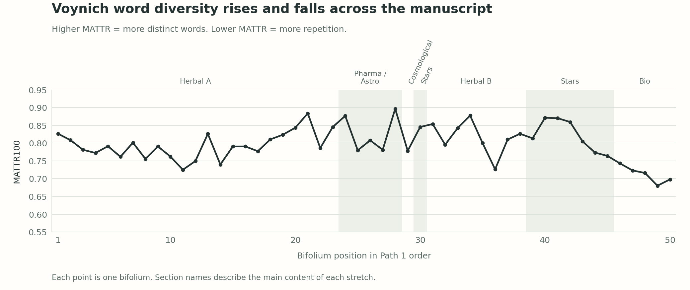

*The manuscript alone, using this study's saved measurements. Each point is one bifolium, with 100-word windows contained within it. Path 1 is the proposed bifolium order used for these comparisons; section names describe the main content of each stretch.*

The investigation has two parts: first, can the page layout produce similar swings in comparison texts and self-citation models? Second, does the manuscript itself show the local relationship between available material and repetition that a copying explanation would predict?

## Test 1: Can changes in page layout explain the MATTR swings?

The clearest pattern to explain is the manuscript's rise into Stars and fall into Bio. To test whether layout could produce it, I compare historical texts, Markov controls and self-citation models in the same page layouts.

### Method: historical texts and models in the same layout

For the controls, I replaced their text directly into the same positional arrangement using the Voynichese positional data. Here is f75r with the manuscript's words, the German herbal *Gart der Gesundheit* (1487), and a Markov control.

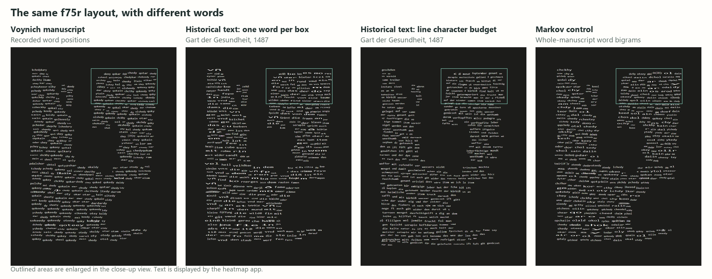

*The historical text is placed in two ways: one word per recorded manuscript box, or whole words filling each line's character budget. The Markov example uses one generated word per manuscript box. The outlined area is enlarged in the close-up view.*

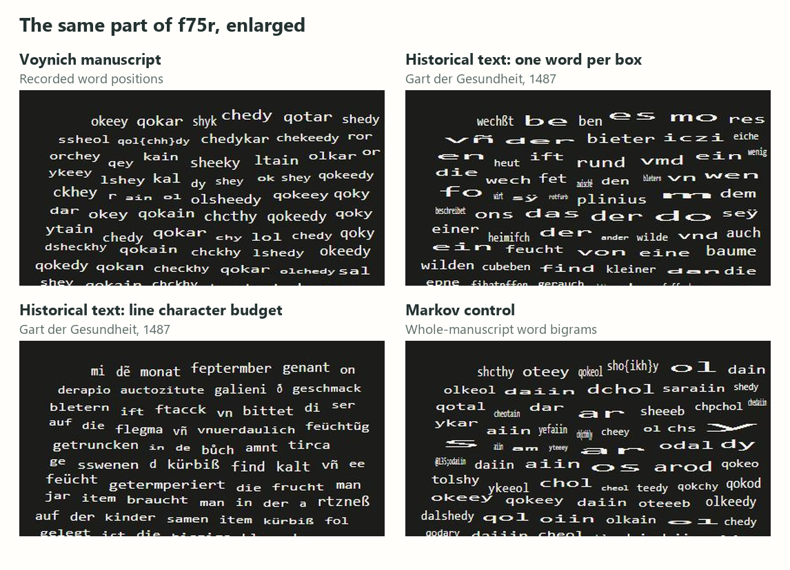

*These are the same page coordinates in all four panels. One word per box keeps the manuscript's word positions; filling the character budget allows different numbers and lengths of words within each line. The heatmap app fits each word label to its box.*

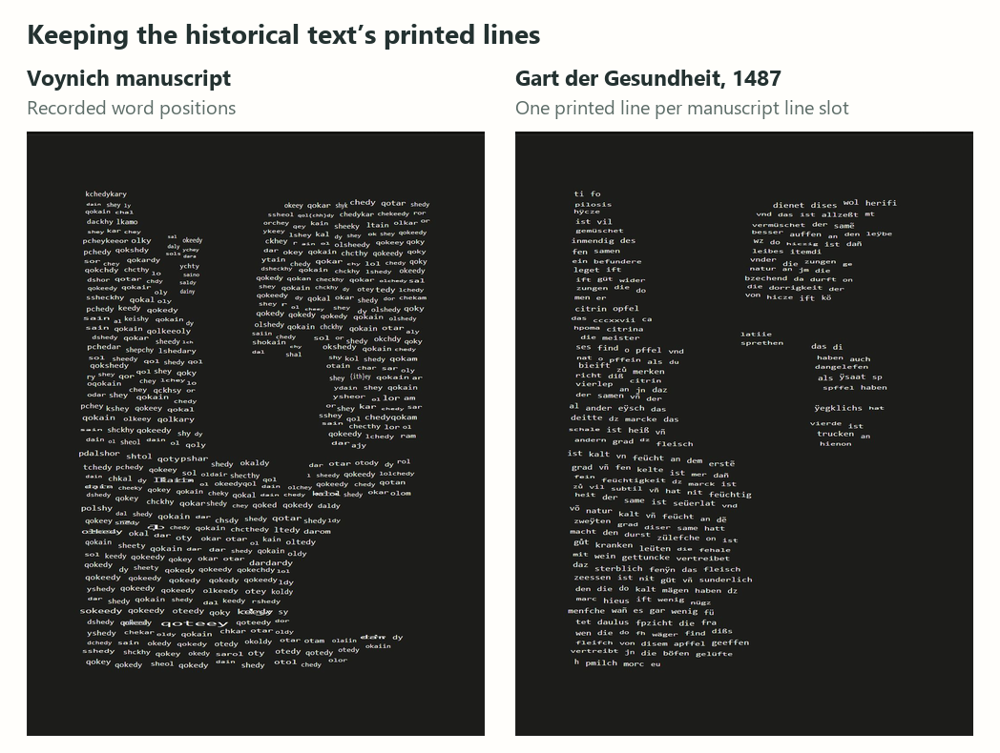

*The spatial test below also uses a third historical control: it keeps the text's own printed line breaks, placing one printed line at each manuscript line slot. Its words therefore form a different shape. All three views are screenshots from the heatmap app's text display.*

I calculate MATTR100 over the same bifolia for five historical texts, using one word per box and filling each line's character budget. Each text is shown separately so we can compare its rises and falls with the manuscript's. The copying models generate words within the manuscript's line, paragraph and page structure; the Markov controls use its word statistics.

### Natural-language controls do not show the same broad MATTR swings

Normal text repositioned into the Voynich manuscript's layout does not reproduce its broad rise into Stars and fall into Bio. The five historical texts are shown separately below, each compared with the manuscript across the same bifolia.

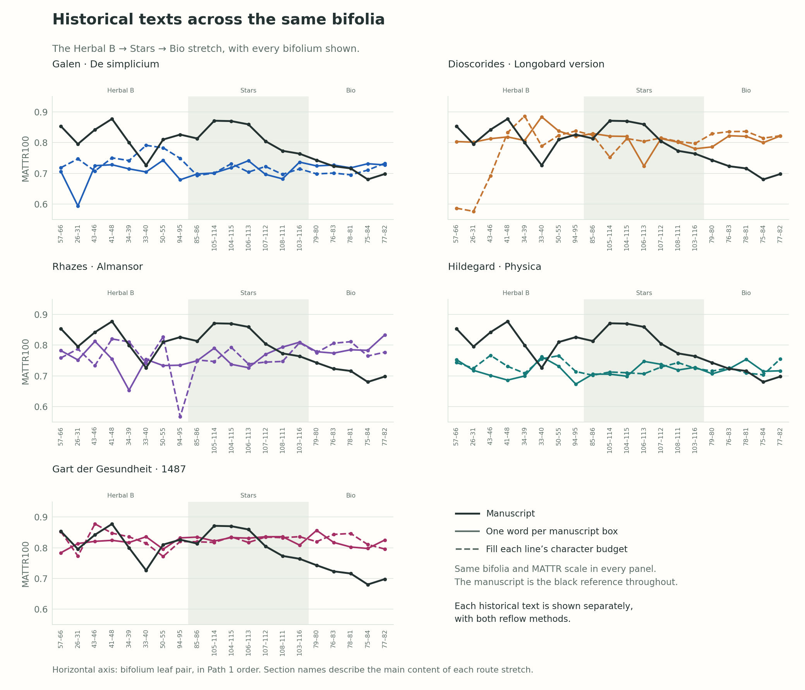

*Solid colored lines place one word in each manuscript box; dashed lines fill each line to its character budget. Black is the manuscript in every panel. The texts fluctuate, but the same page layout does not impose a shared late decline on them.*

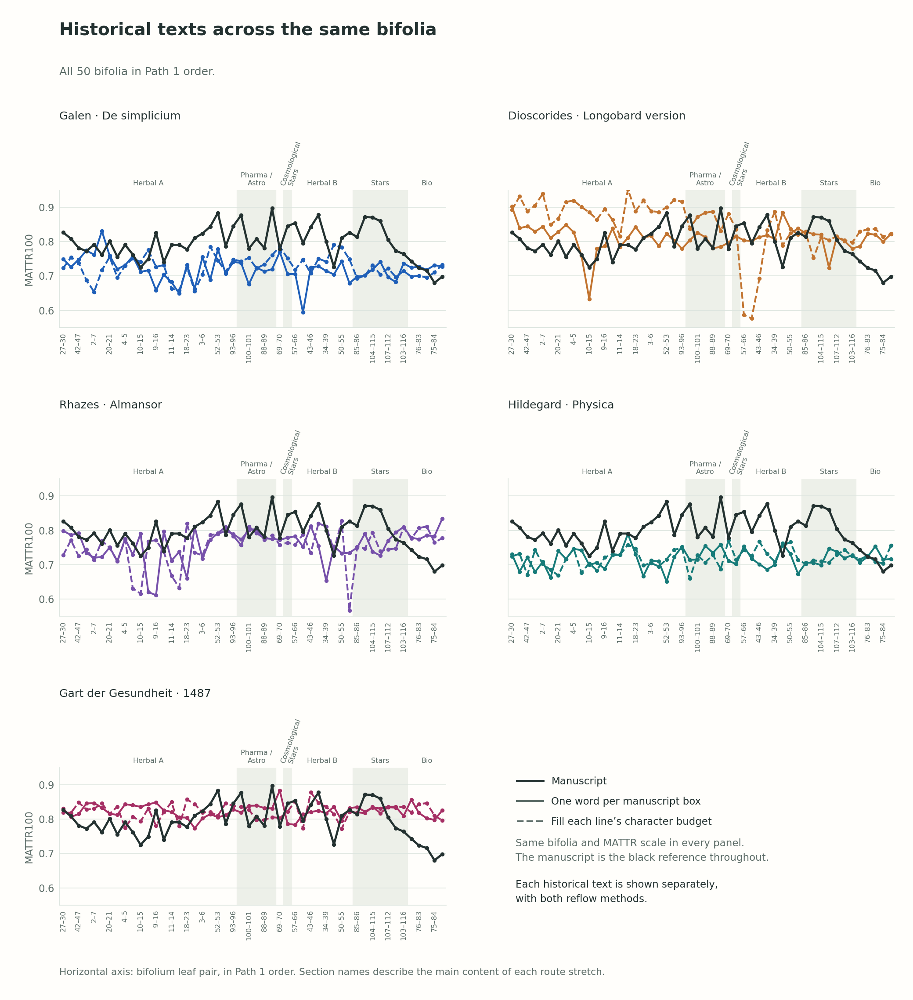

*Five historical texts across all 50 bifolia. Black is the manuscript; solid colored lines use one word per box, and dashed lines fill the line character budget.*

Historical group averages and size of the changes

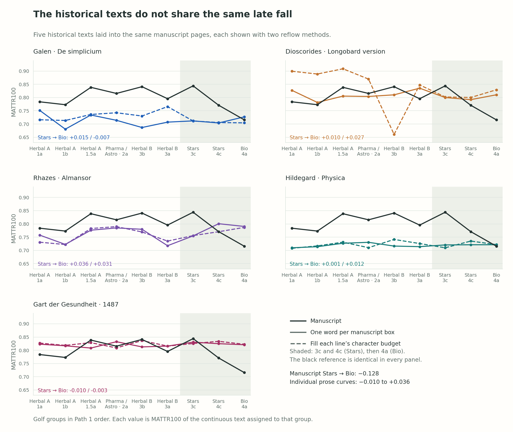

*Group averages for each historical text, with both placements and the manuscript reference.*

Across their ten text/reflow curves, the Stars-to-Bio change ranges from **−0.010 to +0.036**, compared with **−0.128** in the manuscript. The two curves that move in both directions are the two reflows of *Gart der Gesundheit*, with much smaller changes.

### Markov controls do not predict the swings from layout alone

A Markov control generates new text using the manuscript's existing words, favoring words that are common and pairs that often occur together. Each next word is chosen using the previous word; the generator does not consult the words physically above it. The generated words are then placed into the same manuscript layout.

**This tests whether the MATTR swings follow simply from which words are common and which tend to occur together.**

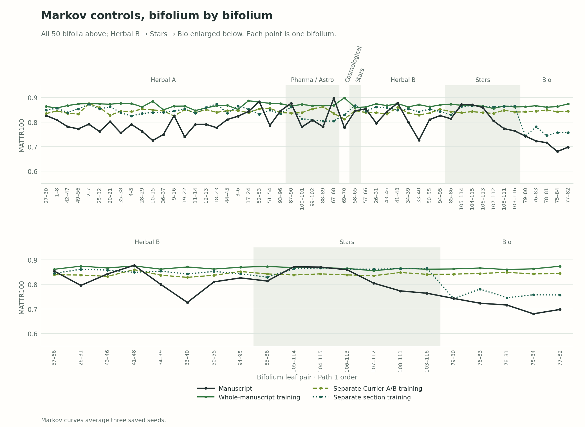

*Three versions learn from the whole manuscript, its Currier A and B text varieties separately, or each illustration section separately. The upper panel shows all 50 bifolia; the lower panel enlarges Herbal B → Stars → Bio. Curves average three saved runs.*

**The whole-manuscript and Currier A/B controls stay nearly flat across Stars and Bio.** Training separately on each illustration section does produce a Bio drop, but that control has been given Bio's own vocabulary and repetition patterns. It reproduces a difference already present in its input. The copying comparison below asks whether the rise and fall can emerge from fixed rules as the layout changes.

### Self-citation predicts some broad MATTR swings from layout alone

**Original Timm predicts the rise into Stars and fall into Bio from layout alone.** Its copying and mutation settings stay fixed across sections; the line lengths, paragraph breaks and page breaks change. The spatial variant also keeps its settings fixed and selects its sources from the words physically in view.

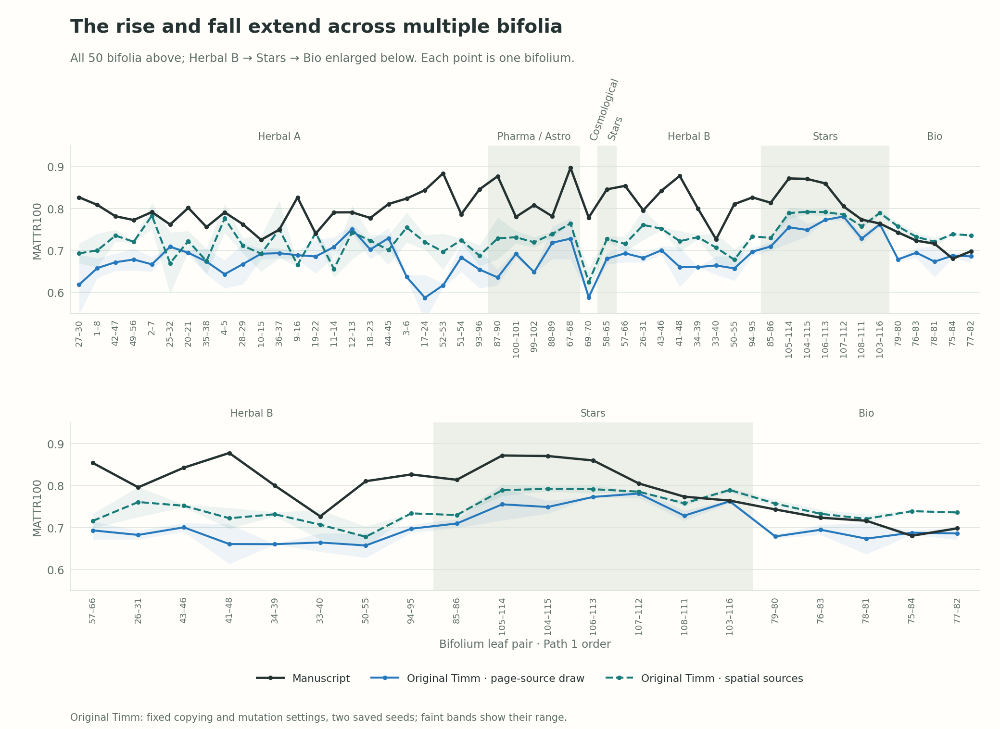

*Each point is one bifolium, identified by its leaf pair. The upper panel shows the whole route; the lower panel enlarges Herbal B → Stars → Bio. The copying curves average two saved seeds, with faint bands showing their range. Section names describe the main content of each route stretch.*

The manuscript and the copying models rise and fall together over multiple bifolia in this late stretch.

Group averages, exact changes, and the governed copying variants

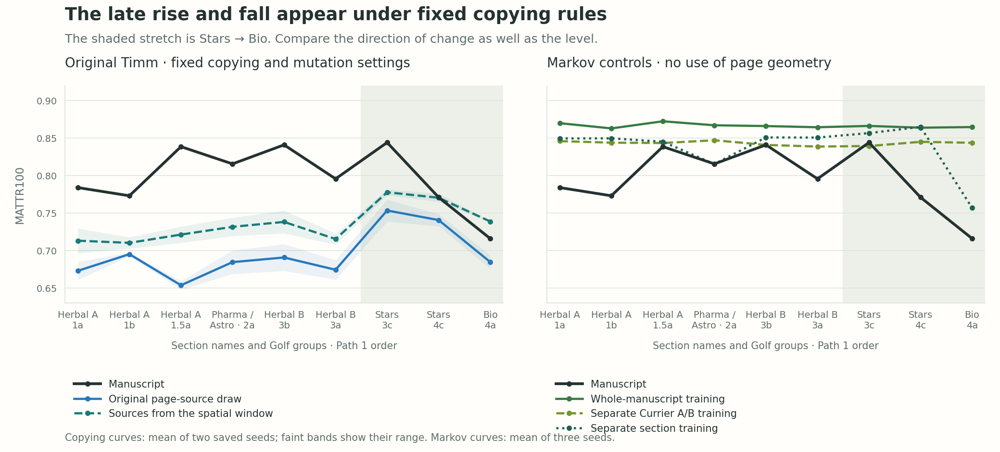

*These are the group averages, with section names alongside the Golf codes. The shaded stretch covers Stars (3c and 4c) and Bio (4a).*

The manuscript rises from **0.796 to 0.844** on entering Stars (3a → 3c), then falls to **0.716** in Bio. Original Timm moves **0.674 → 0.753 → 0.684** across the same groups; its spatial variant rises and falls there too. The agreement is strongest for these late changes: Original Timm moves the wrong way at the earlier 1b → 1.5a rise, and reproduces only a small part of the 3c → 4c fall.

| Text | Into Stars: 3a → 3c | Stars to Bio: 3c → 4a |
|---|---:|---:|
| Manuscript | +0.049 | −0.128 |
| Original Timm, original page draw | +0.079 | −0.069 |
| Original Timm, spatial source window | +0.062 | −0.039 |
| Markov: whole manuscript | +0.002 | −0.002 |
| Markov: Currier A/B | +0.001 | +0.004 |
| Markov: by section | +0.006 | −0.100 |

The governed copying variants also rise into Stars and fall into Bio. They use fitted composition targets, so Original Timm is the clearest test of what the copying rules and page structure produce on their own.

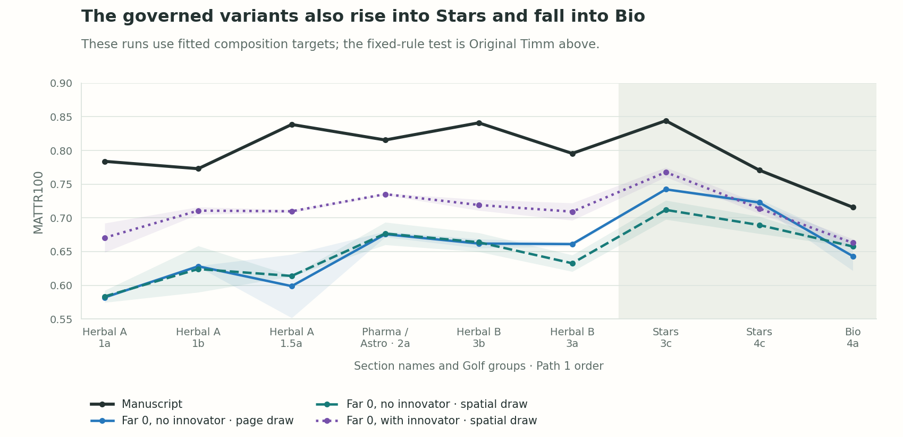

*These variants use fitted composition targets. Original Timm is the comparison with fixed copying rules.*

The bifolium charts use MATTR100 with windows wholly inside each bifolium; the group charts use windows wholly inside each Golf group. Both follow Path 1 order and use the saved [layout_controls.json](layout_controls.json). Recomputing the manuscript and ten saved copying streams matched every bifolium value exactly. No models were regenerated. [Bifolium values and verification](summary_figures/mattr_bifolia.json); [bifolium figure builder](summary_figures/build_bifolium_mattr.py); [group values](summary_figures/mattr_swings.json); [group figure builder](summary_figures/build_mattr_swings.py).

## Test 2: Could local copying help explain the MATTR shifts?

The models suggest a possible mechanism: page constraints reduce the diversity of words available to the author. If words are copied or assembled from nearby material, fewer available components could make an existing spelling more likely to be repeated.

**If words are written by copying or modifying existing words, then a word should be more likely to be a repeat when the material available above it is less diverse.** Reusing an existing spelling instead of introducing a new one reduces the number of distinct words in a fixed-size window, lowering MATTR. This would connect local diversity shortages to the broader MATTR declines.

### Method: the spatial window and diversity score

I'm using the spatial data to directly calculate diversity windows around a word. For each word, the recorded manuscript coordinates define a possible source pool: earlier words on the same page, up to eight line spacings above it in a cone with a 45-degree half-angle, plus three median word widths to its left. At most 100 sources are retained, weighted by distance and alignment.

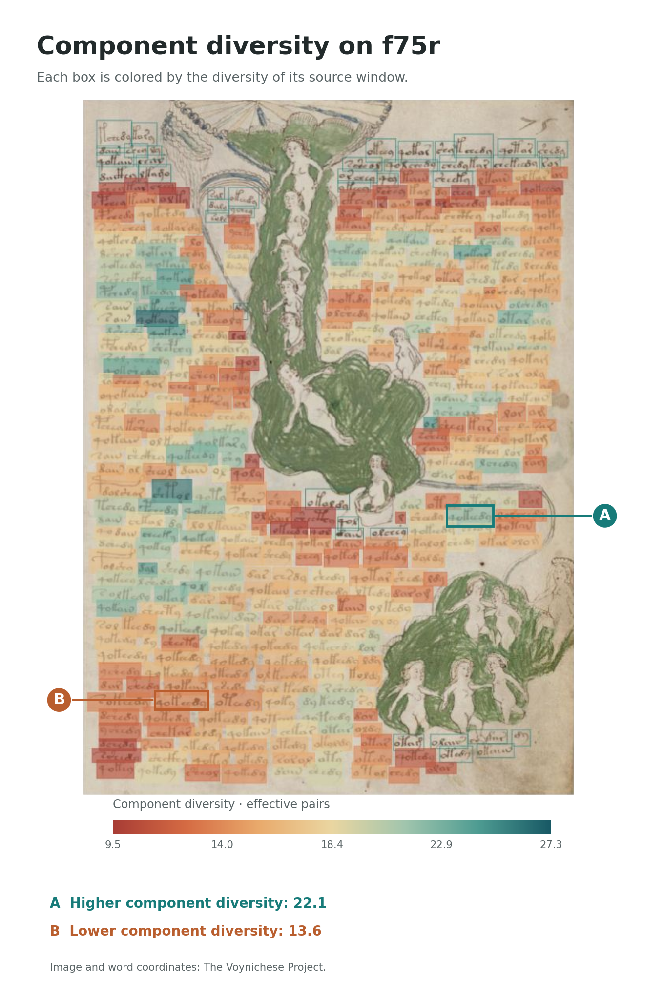

*Each word box is colored by the component diversity of its source window: warm colors are lower, teal is higher. A and B mark the two examples shown below.*

I can then plot the overall diversity of the word components, and the conditional H2 entropy of the glyphs within those words, for each target word. The pool is scored three ways:

- **Component diversity:** the effective number of different adjacent glyph-unit pairs within its words. More varied pairs give a higher score.
- **Glyph H2:** how unpredictable the next glyph unit is given the preceding unit, measured within words.
- **Source word diversity:** how unlikely two weighted draws from the pool are to have the same spelling.

Here are the two qokeedy occurrences on f75r. The target spelling is the same, but the component diversity around it differs: **22.1 effective pairs in A, versus 13.6 in B**. The lower-diversity window is dominated by similar qokeedy/qokedy forms, which reuse pairs such as q·o, o·k and d·y.

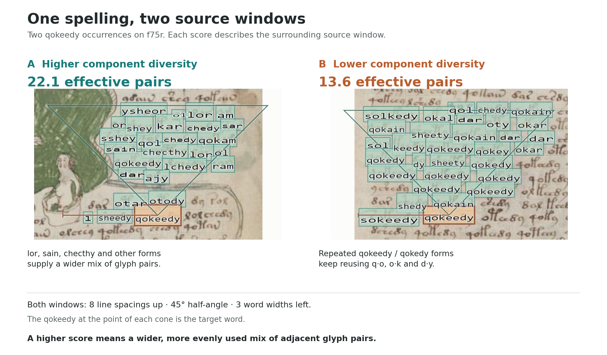

*Both close-ups use the same spatial settings. The page image and registered word boxes come from The Voynichese Project.*

I apply the same source selector to each control's words in its page layout. German components are measured as letter pairs; Voynichese uses glyph-unit pairs.

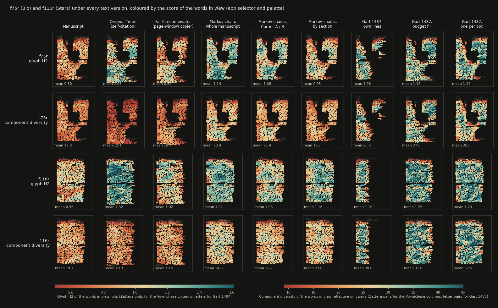

*Examples from Bio (f75r) and Stars (f116r). The maps show the spatial pattern; the following statistics measure its relationship to repetition.*

#### Connecting the source pool to repetition

We then measure whether words with a less diverse copying window are more often repeated in the surrounding text.

Each target receives a **repeat score**: the fraction of all 100-word windows containing it in which its spelling occurs at least twice. These windows extend both before and after the target.

Within each bifolium, compare targets in the lowest and highest fifths of source diversity. Repeat this within three source-pool-size bands and average the contrasts. A positive result means more repetition beside a less diverse pool.

Worked example: from a source window to a repeat score

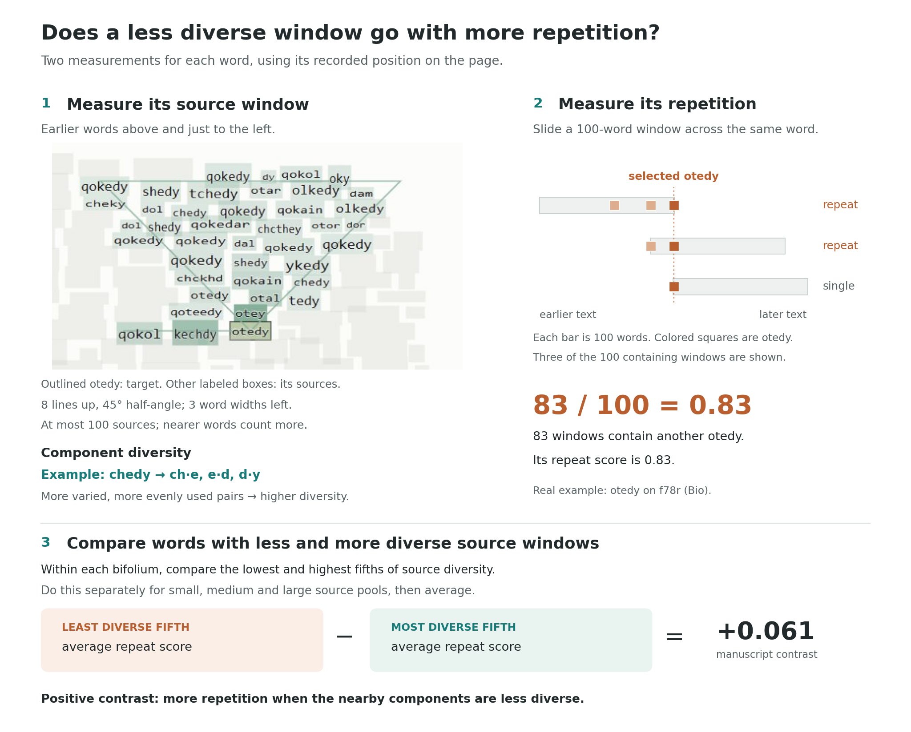

*The repeat-score example uses otedy on f78r. The same two measurements are made for every scored word.*

### Words with less diverse source material are more often repeats

For manuscript words with the lowest component diversity in their source windows, the mean repeat score was **6.1 percentage points higher** than for words with the highest diversity. This compares the lowest and highest fifths within bifolia and similar source-pool sizes. Glyph H2 gave a similar **5.7-point difference**.

The component-diversity difference fell to **2.1 points after shuffling within paragraphs**, and **0.2 points after shuffling within pages**. The two original self-citation configurations produced larger differences, **10.5 and 11.4 points**. The tested Markov and German-text controls had smaller component and H2 differences than the manuscript.

> **Correction (28 October, evening).** The shuffle figures above kept the recorded word boxes, so 42 percent of the shuffled words sat in a box more than 1.5 times too wide or too narrow; re-typeset into the line frames, the paragraph shuffle keeps the raw difference (+5.4 points against +3.8 for the manuscript in the same geometry). Most of the raw difference is an effect of the target's own length: with inverse-square distance weights a short target's left neighbour sits closer and dominates the window, and short words are the frequent ones; inside exact word-length classes the component difference is −0.9 points. Under joint control for exact length and source-pool size a smaller association remains, **+2.6 points for component diversity and +3.5 for H2**, above all 19 length-matched paragraph shuffles, about half the copying models' for components and of their size for H2 on all words; on interior words alone (line-edge words and truncated windows removed) the lines above by themselves give +2.5 to +4.0 points for components and +2.2 to +3.7 for H2, and the lines below give the same; against 30 length-matched paragraph shuffles scored in the same geometry, the part that word order inside the paragraph carries is +1 to +3 points over the baseline for the manuscript (H2 the most consistent, one-sided p 0.03 to 0.1 by geometry and cohort; components weaker), and the copying models' own excesses over their own shuffles are of the same small order (Timm's page copier close to zero); their much higher observed values sit in their shuffle baselines, that is, in their paragraph-level concentration. One passage of a Latin medical treatise shows an excess of the manuscript's size and another passage none. Its mechanism is unresolved. See RESULTS.md, section 7, item 9 and its review paragraph; scripts `residual_check.py`, `length_class_check.py`, `sweep_check.py`, `shuffle_layout_check.py`.

The original comparison, before accounting for source-pool size, also found a positive association: **3.4 points**, with a **95% interval of 1.4–5.4 points**, excluding zero.

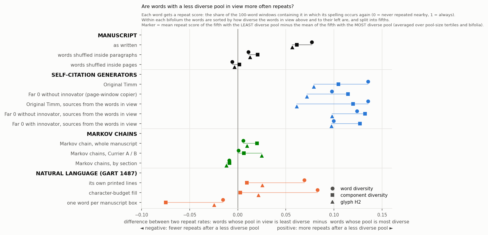

#### What these results suggest

- **Word placement matters, but less than first measured.** The shuffle that removed the relationship kept the recorded boxes; re-typeset and length-matched, 19 paragraph shuffles leave a residual that the manuscript still exceeds under joint length and pool-size control (correction above).
- **The effect is smaller than current pure copying models predict.** The manuscript shows about half their effect after accounting for source-pool size, or roughly one-third in the original comparison.
- **Local copying could contribute to the MATTR declines.** The observed relationship fits the prediction that a restricted supply of components makes existing spellings more likely to be reused, reducing word diversity.

Effect sizes and exact contrasts

The table gives differences in mean repeat score after dividing targets into source-pool-size bands. A contrast of +0.061 is a difference of 6.1 percentage points.

| Text | Component-diversity contrast | H2 contrast |
|---|---:|---:|
| Manuscript | +0.061 | +0.057 |
| Words shuffled within paragraphs | +0.021 | +0.013 |
| Words shuffled within pages | +0.002 | -0.003 |
| Original Timm self-citation | +0.105 | +0.079 |
| Far 0 without innovator | +0.114 | +0.072 |
| Markov: whole manuscript | +0.020 | +0.010 |
| Markov: Currier A/B | +0.006 | +0.025 |
| Markov: by section | -0.008 | -0.012 |

The manuscript's component contrast is **54–59%** of the two original page-copying configurations' contrasts. Before dividing targets into source-pool-size bands, the manuscript estimate is **+0.034**, versus generator seed means of **+0.115 and +0.118**: about **29%** of their effect. The original manuscript interval was calculated by resampling bifolia. “Pure” copying refers to copying and mutation without the separate slot innovator.

### Herbal B does not show the same association

Here is what it looks like by manuscript/illustration section, with **Herbal A and Herbal B separated by their Currier classification**. Each page is assigned to its own section. I removed word diversity as it is noisier by section.

**The association does not seem to be present in Herbal B:** both the component-diversity and H2 contrasts are close to zero.

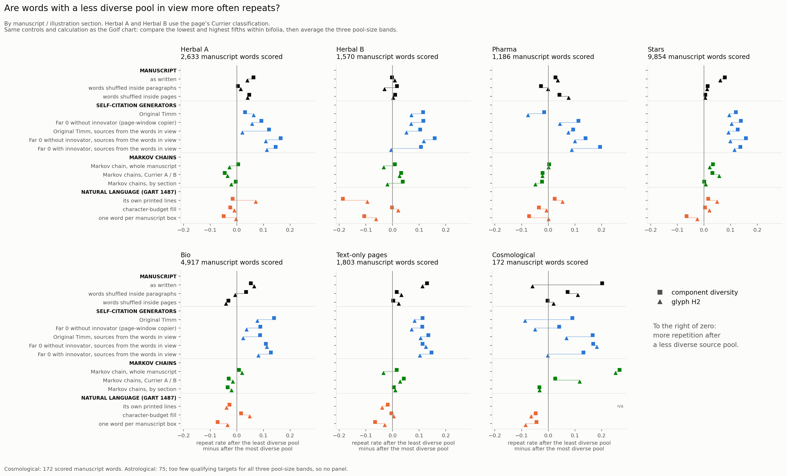

*The controls, source windows and repeat-score calculation are the same as above. Panel counts are scored manuscript words. The Cosmological sample is small (172); the Astrological pages have 75 and too few qualifying targets for all three pool-size bands, so no contrast is plotted for them. [Values and page assignments](summary_figures/illustration_contrasts.json).*

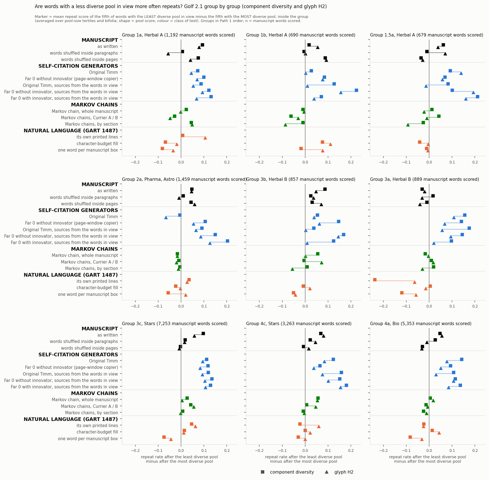

*The Golf 2.1 view shows the finer group differences. Specifically, **3a does not appear to be affected** in the predicted direction (component/H2 contrasts -0.030 and -0.020). The positive contrast appears in the large late groups: **3c and 4c (Stars), and 4a (Bio)**. Smaller groups have noisier estimates. Group 2a includes Pharma and other material.*

Pharma is harder to interpret because of the way the text is written on the foldouts across horizontal sheets.

### Source diversity also tracks MATTR

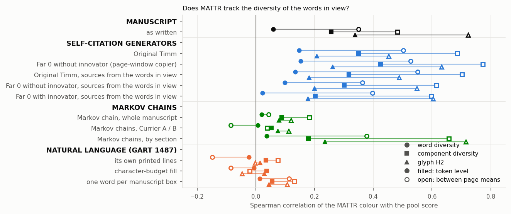

The reported Spearman correlation between this “source” diversity and MATTR is positive: **+0.26 for component diversity and +0.34 for H2** at token level, rising to **+0.48 and +0.72** between page means. Filled markers show token correlations; open markers show page-mean correlations. Connecting lines are not confidence intervals.

This is complementary evidence at a broader scale. Paragraph shuffles preserve word inventories, so MATTR windows covering much or all of a paragraph can retain the relationship. The section-trained Markov control also produces strong page-level coupling (+0.66 and +0.72). Section-level differences in vocabulary and glyph combinations can therefore produce this broader coupling too.

## Conclusion

Self-citation models predict some of the manuscript's broad MATTR swings with fixed copying rules, simply as the page layout changes. The historical controls do not show the same response to layout.

The manuscript also shows the local relationship that could help explain those swings: **words with less diverse material in their copying window are more often repeats.** Most of the raw effect is the target's own length seen through the distance weighting; under joint control for length and source-pool size a residual of +2.6 points (components) and +3.5 (H2) remains, above 19 length-matched shuffles, about half the copying models' for components and of their size for H2 (correction above), and it does not seem to be present in Herbal B.

**My interpretation, revised 28 October: the raw contrast is not diagnostic of copying; a residual local association survives the corrected controls, and whether it comes from the words above, from memory of what was just written, or from composition is not settled by these tests.** It does not establish that the current self-citation models describe how the manuscript was produced.

Numbers, definitions, and reproduction

This summary uses the saved outputs of the 26–27 October 2026 study. The table and contrast figures use the pool-size-stratified statistic in [mechanism_check.json](mechanism_check.json), computed by [mechanism_check.py](mechanism_check.py) and [component_check.py](component_check.py). The original unstratified comparison and its manuscript confidence interval come from [component_check.json](component_check.json), section 7 of the longer report; the generator values average three seeds each. The contrast figures show point estimates; their connecting lines are not uncertainty intervals.

The correlations come from [mattr_vs_components.json](mattr_vs_components.json) and [mattr_vs_components.py](mattr_vs_components.py). The existing routine labels them Spearman correlations but assigns ordered ranks to ties rather than averaging tied ranks; they are reported here as rounded descriptive values. Overlapping windows are not independent observations. Page means include only pages with at least 100 scored tokens (72 manuscript pages).

See [README.md](README.md) for reproduction and [RESULTS.md](RESULTS.md) for the full analyses, including the separate question of whether the generators reproduce the manuscript's MATTR trajectory.

